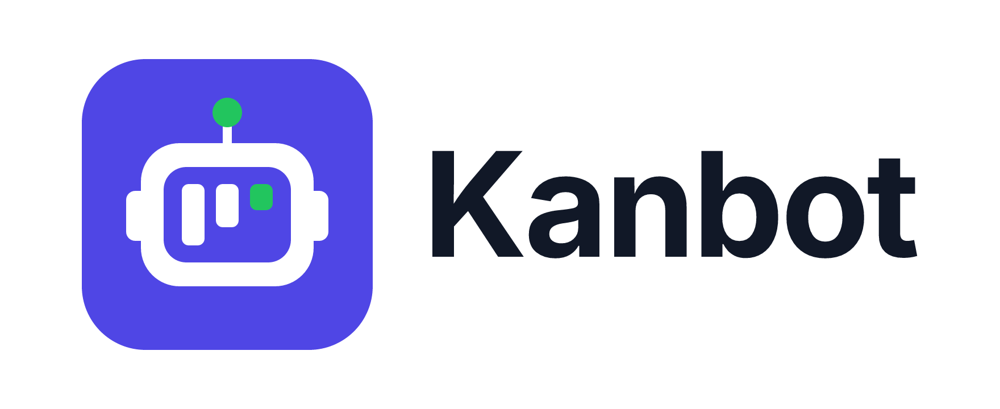

<p align="center"></p>

# Kanbot — client

> The React app for **Kanbot**, a personal sprint board with an AI teammate: a backlog, sprints, a
> four-column board and an assistant that drafts todos, plans sprints and summarises them. The
> Express API in [`server/`](../server/) is the contract and was not changed.

**Live:** **<https://kanbot-ai.vercel.app>** — log in with `demo@kanbot.dev` / `password123`
(data resets to the seed on every server restart; see [§12 Deployment](#12-deployment)).

**Status:** complete — every functional requirement (AUTH, PRJ, BL, SPR, AI) is done; see
[§7 Progress](#7-progress). Built phase by phase from [`docs/FRONTEND-PLAN.en.md`](../docs/FRONTEND-PLAN.en.md).

---

## 1. Overview

The visual reference is the [design canvas](https://claude.ai/code/artifact/efe99d87-baac-4bb7-96e1-235363299397) (every screen, light and dark, 1440 and 390); the [demo](#13-demo) shows the app running.

- **Auth** — register, log in, stay signed in across reloads, `?redirect=` back to the page you asked for, session-expiry dialog, log out.
- **Projects** — grid with search, create / edit / delete with confirmation, a project switcher in the sidebar.
- **Backlog** — active, planned and backlog groups; quick create; search and filters in the URL; Todo details for every field; drag and drop, ↑/↓ keys and a ⋯ menu to reorder and move between sprints, with Undo.
- **Sprints** — create, edit, delete (planned), start, complete (unfinished → backlog or a planned sprint), history with stats.
- **Board** — four columns, live progress, drag and drop, ← → ↑ ↓ keys and a ⋯ menu, a composer per column.
- **AI** — chat drawer (Markdown, per-project history), Generate todos (editable drafts, one bulk save), Plan sprint (within a capacity), sprint summaries. Nothing is saved until you confirm.
- **Polish** — light and dark themes (following the OS until you choose), a 404 for every cause, error boundaries, keyboard shortcuts, offline banner, 1440 → 390px layouts, reduced motion.

## 2. Getting started

Requirements: **Node 24** (`.nvmrc`; 22.22+ also works).

```bash
# Terminal 1 — API on :4000 (mock AI unless AI_API_KEY is set in server/.env)
cd server
npm install
cp .env.example .env
npm run seed          # demo account: demo@kanbot.dev / password123
npm run dev           # http://localhost:4000/api/health

# Terminal 2 — client on :5173
cd client
npm install
cp .env.example .env  # optional: VITE_API_URL defaults to /api
npm run dev           # http://localhost:5173
```

`VITE_API_URL=/api` goes through the Vite proxy (`server.proxy` and `preview.proxy`) to
`http://localhost:4000`, so every request is same-origin and the server's CORS rule
(`CLIENT_ORIGIN=http://localhost:5173`) holds on any port — `vite preview` on 4173 and
Playwright included (plan §9.1). `strictPort: true` makes Vite fail instead of moving to 5174.

## 3. Scripts

| Script | What it does |
|---|---|
| `npm run dev` | Vite dev server on 5173 (`/api` → 4000) |
| `npm run build` | `tsc -b` then the production build in `dist/` |
| `npm run preview` | Serve `dist/` on 4173 (same proxy) |
| `npm run typecheck` | `tsc -b` for the app, the configs and the e2e specs |
| `npm run lint` | ESLint (zero warnings) + `scripts/check-css.mjs` (no hex outside `tokens.css`, logical properties only, `global(kbX)` keyframes in CSS Modules) |
| `npm run format` / `format:check` | Prettier write / check |
| `npm run test` | Vitest (watch); `npm run test -- --run` once |
| `npm run e2e` | Playwright: starts the API and `build + preview` itself (see [§10](#10-testing--ci)) |
| `npm run icons` | Regenerate `src/components/Icon/icons.ts` from `@atlaskit/icon` |
| `npm run analyze` | Production build + `stats.html` bundle report (gzip sizes) |

## 4. Tech stack and why

| Area | Choice | Why |
|---|---|---|
| Build | Vite 8 + React 19 + TypeScript 6 (strict, `noUncheckedIndexedAccess`) | Fast dev server; strict types catch drift from the API contract. TS 6, not 7: `typescript-eslint`'s type-checked rules support `< 6.1` |
| Styling | CSS Modules + one global `tokens.css` | The design is built on CSS variables: zero runtime, scoped, 1:1 with DESIGN.md |
| Server state | TanStack Query v5 | Cache, retries, cancellation (`signal`), optimistic updates, serialized mutations (`scope`) |
| UI state | Zustand (+ `persist`) | Small stores with selectors, callable outside React (the API client expires the session on a 401) |
| HTTP | Native `fetch` in one `request<T>()` | 0 KB; TanStack Query already gives retry and cancellation; timeouts via `AbortSignal.timeout` |
| Primitives | Radix Dialog / AlertDialog / DropdownMenu | Focus trap and restore, Esc, roving focus, `aria-*` — well tested and unstyled |
| Forms | react-hook-form + zod | Validate on blur, then on change (DESIGN §10.5); client limits = API limits |
| Drag and drop | dnd-kit | Pointer, touch and keyboard sensors, screen-reader announcements |
| Markdown | react-markdown, lazy | No `rehype-raw`, so AI HTML is shown as text (NFR-7); loaded only with the AI UI |
| Icons | Own `<Icon>` + a generated path map | `@atlaskit/icon` pulls in emotion and tokens; we ship only the paths |
| Fonts | `@fontsource-variable/inter`; `@fontsource/ibm-plex-sans-arabic` 400–700 in the lazy Arabic chunk | No Google Fonts round-trip; English visitors never download the Arabic font |
| i18n | Typed TS dictionaries + native `Intl` (no library) | Two locales: missing keys are type errors, 0 KB runtime, plurals and Levantine months from the platform |
| Quality | ESLint 9 (typescript-eslint strict type-checked, react-hooks, react-refresh, jsx-a11y), Prettier, Vitest + Testing Library + MSW + vitest-axe, Playwright + axe-core | NFR-1, NFR-8, Requirements §9 |

## 5. Architecture

```
src/
├── main.tsx, router.tsx    # providers; routes (guest + private layouts, lazy pages)
├── routeChunks.ts          # lazy page imports, shared by the router and hover/focus prefetch
├── app/                    # Providers, queryClient, global hosts (Toaster, LiveRegion)
├── api/                    # client.ts (request<T>), errors.ts (ApiError), one module per resource — the only fetch
├── hooks/                  # queryKeys.ts + every query and mutation (useProjects, useTodos, useMoveTodo, useBoard, useAi…)
├── i18n/                   # useT / useLocale / setLocale / useFormat, en + lazy ar dictionaries, Intl formatting
├── stores/                 # Zustand UI state only: session, theme, locale, toast, announcer, assistant, highlight, notFound, shortcuts
├── components/             # design system (Button, Field, Dialog, Menu, Lozenge, ProgressBar, Skeleton, PageError…)
├── features/               # auth, shell, projects, backlog, sprints, board, todos, ai, errors — each exports its pages
├── lib/                    # dates, format (English bridge until R5), moveInLists (the DnD model), board helpers, dnd/ (shared sensors + preview), storage…
├── styles/                 # tokens.css, base.css, motion.css
├── test/                   # setup, MSW server and a fake API, renderApp (real routes on a memory router)
└── types/api.ts            # verbatim copy of server/src/types/api.ts — never edited by hand
e2e/                        # Playwright specs + support.ts (API setup, pointer drag, axe)
```

**State (plan §5.2).** Server data lives only in TanStack Query (one key factory, `hooks/queryKeys.ts`).
Zustand holds UI state: the token (the only persisted credential), theme, toast, live-region
announcements, the AI drawer and chats per project. Filters, search and the open todo (`?todo=`)
live in the URL. `signOut()` resets the stores and calls `queryClient.clear()`.

**API layer.** `request<T>(method, path, { body, query, signal, timeoutMs })` adds the bearer token,
turns non-2xx into `ApiError { status, code, message, details }`, no response into `NETWORK_ERROR`,
a timeout (15 s; 45 s for AI) into `TIMEOUT`, keeps TanStack's cancels as cancels, and on a 401 for
an authenticated request (not `/auth/login`) expires the session (AUTH-6). `fieldErrors()` maps
`details[]` onto form fields. ESLint bans `fetch` outside `src/api/`.

**Data flow highlights.**
- *No waterfalls (NFR-6):* the backlog loads todos and sprints in parallel (one todo list, split by sprint client-side); the board request starts from `project.stats.activeSprint` without waiting for the sprint list; hover and focus prefetch the project, its data and the page chunk.
- *Optimistic moves (BL-5, SPR-5):* `useMoveTodo` applies the server's move rule (`lib/moveInLists.ts`, unit-tested) to every cached list at once, runs requests one at a time per project (`scope`), moves only the failed todo back with a toast, and invalidates once the last move settles.
- *AI:* plain mutations; nothing is saved until the user confirms (bulk create, create sprint). The summary request state is read from the mutation cache, so a card shows a request started anywhere.

| Auth situation | What happens |
|---|---|
| Signed out on a private page | `/login?redirect=<page>` (AUTH-5); the redirect is sanitised to same-origin app paths |
| Signed in on `/login` or `/register` | sent to `?redirect=` or `/projects` |
| Reload with a token | `GET /auth/me` behind a full-page loader; 401 → login (AUTH-3) |
| 401 mid-session | non-dismissable "Your session has expired" dialog → `/login?redirect=<page>` with the message (AUTH-6) |
| Log out | clears token, stores and cache → `/login` (AUTH-4); other tabs follow through the `storage` event |

### Arabic and RTL (i18n)

Behind `VITE_FEATURE_AR` (set to `true` on Vercel Preview only; production is English until R5),
delivered in five PRs — R1 foundation (done) · R2 auth + shell + projects · R3 backlog + todo +
sprints · R4 board + history + AI + 404 + errors · R5 RTL pass + enable (plan §11). Terms:
[`docs/I18N-GLOSSARY.md`](../docs/I18N-GLOSSARY.md); design: the [Arabic canvas](https://claude.ai/code/artifact/75890d4c-d82e-4f3b-bb09-8d085c7a6877).

- **API:** `const t = useT()` → `t.count.todos(3)`; `useFormat()` → `format.range(start, end)`;
  `useLocale()`, `useDirection()`, `setLocale('ar')`; `getT()` / `getFormat()` outside React.
- **Dictionaries:** `i18n/messages/en.ts` is the source of truth (`Messages` is derived from it);
  `ar.ts` `satisfies Messages` and is a separate chunk (with the font), loaded only when Arabic is
  chosen. A dev-time and a unit-test check compare their shapes.
- **Formats:** `en-US` and `ar-SY-u-nu-latn` (Levantine months, Latin digits), plurals with
  `Intl.PluralRules` (Arabic's six forms).
- **Direction:** `<html lang dir>` from the locale store and, before paint, from `index.html`;
  Radix `DirectionProvider`; `var(--dir)` and `.flip` for the RTL pass in R5.
- **Switchers:** ع / EN on the auth pages, "English · اللغة" in the sidebar — only with the flag.
- **Screens:** none migrated yet; `lib/format.ts` re-exports the English formatter so their output
  is unchanged. Migrated folders get `react/jsx-no-literals` as an error (`I18N_MIGRATED` in
  `eslint.config.js`).

## 6. Design implementation

- **Source:** the [design canvas](https://claude.ai/code/artifact/efe99d87-baac-4bb7-96e1-235363299397) (`project/Main.dc.html`: every screen and state, light and dark, 1440 and 390) and [`design/DESIGN.md`](../design/DESIGN.md) for values.
- **Tokens:** `styles/tokens.css` holds DESIGN §3.2 colours verbatim (`.light` / `.dark` on `<html>`), plus spacing, radius, sizes, dialog widths, fonts and easing — the **only file with hex colours** (ESLint for TS, `scripts/check-css.mjs` for CSS, which also rejects physical CSS properties).
- **Theme:** an inline script in `index.html` sets the class before first paint; it follows `prefers-color-scheme` live until the toggle is used, then the choice sticks (`kanbot.theme`); 300 ms cross-fade; `theme-color` meta tags follow it.
- **Motion:** DESIGN §8.3 keyframes verbatim in `styles/motion.css`, audited row by row against §8.2; reduced motion turns animations and stagger delays off.
- **Icons and logo:** the 34 icons of DESIGN §5.2 (+ `priority-highest` for urgent) copied as paths by `scripts/extract-icons.mjs`; Task/Story SVGs from §5.3; the logo with `--logo-*` tokens.
- **Components:** every one with its states in a dev-only catalogue, `/__ui` (both themes side by side).

### Deviations from the design, and why

Priority on conflict: API contract → Requirements AC → design (plan §2).

| Design says | We do | Why |
|---|---|---|
| Priority high / medium / low | Also **urgent** (`priority-highest` icon + label) | The API has four priorities |
| Points 0–40 | Select with 1, 2, 3, 5, 8, 13 or None | API values |
| Project key 2–5 `[A-Z0-9]`, fixed | 2–6 letters, editable, with "Changing the key doesn't change existing todo keys." | API + PRJ-3 |
| Assignee / reporter on cards, dialog, filters | Removed | Single-user API |
| Delete with an Undo toast | Confirm dialog for projects, todos and planned sprints; Undo only for moves | PRJ-4, BL-4 |
| Start sprint starts at once | A small dialog with start (today) and end (+14) | SPR-3 |
| Field limits (title 120, goal 160…) | The API's limits (title 200, goal 300, description 5000, name 80) | Valid values are never rejected |
| Offline edits are queued | No queue: mutations fail at once with the normal error UI; the banner says changes can't be saved until you reconnect | A queue would live in memory, be lost on reload, and kept the Save spinner turning with no feedback |
| URLs by key (`/projects/KAN`, `?todo=KAN-18`) | By id | The API works by id |
| Forgot password | Frontend only, marked "Demo only" | No endpoint; password reset is out of scope |
| A real HTTP 404 | The 404 page with status 200 | An SPA is served as `index.html` for every path; the server can't change |
| Login 401 copy | The server's message ("Incorrect email or password.") | AUTH-2 |
| Tile ⋯ menu Open backlog / Open active sprint / Delete; progress bar on tiles | Open / Edit / Delete; no tile progress bar | PRJ-3 needs Edit; the API has no points per project |
| Sidebar bottom: a Log out icon button | A profile menu (avatar, name, email → Log out, Keyboard shortcuts) | One deliberate step to log out; a home for the shortcuts help |
| Tablet keeps the full sidebar above 760px | A 64px icon rail at 761–1023px with visible tooltips | NFR-4 asks the sidebar to collapse at 768px |
| Sprint history items are buttons (`aria-pressed`) | Links with `aria-current="page"` | The selection is the URL; Back and deep links work |
| Board summary card | An ai button next to Complete sprint opens the summary in a dialog | The canvas board has no card, only that button |
| Plan sprint "Sprint length" select | Left out | The API takes capacity and focus only; dates come with Start |
| Unchecked AI drafts / plan rows at `opacity: .55` | No fill, faded icons, key and title in `--text-subtlest` | `.55` put their text near 3.4:1, under WCAG AA (NFR-5) |
| Dialog header 24 24 0 / footer 16 24 24 | 16 24 with a divider (as every dialog artboard draws it) | The canvas is the reference for look |
| Register strength meter with 3 levels | The canvas's 4 (Too short / Fair / Good / Strong) | Superset; "Too short" matches the 8-character minimum |

## 7. Progress

✅ done, with unit tests and checked by hand · ⚠️ done with a caveat in the note. "E2E:" names
what the Playwright specs add on top (results in [§10](#10-testing--ci)).

| ID | Status | Notes |
|---|---|---|
| AUTH-1 | ✅ | Name, email, password, confirm; zod on blur/submit (required, email, ≥ 8, match); server `details[]` under fields; 409 → "An account with this email already exists" under Email; loading button can't double-submit; success → signed in on `/projects` + welcome toast. E2E: the demo flow registers through the UI |
| AUTH-2 | ✅ | 401 → the server message above the form; success → `?redirect=` (sanitised) or `/projects`. E2E: log in after the token is removed lands back on the board |
| AUTH-3 | ✅ | Token in `localStorage` (`kanbot.token`); `GET /auth/me` behind a full-page loader; 401 clears it and shows login. E2E: reload on the board stays there |
| AUTH-4 | ✅ | Profile menu → Log out: token, UI stores and cache cleared → `/login` |
| AUTH-5 | ✅ | Private page signed out → `/login?redirect=<page>`; `/login`, `/register` signed in → the app. E2E: `?redirect=` after removing the token |
| AUTH-6 | ✅ | Any 401 except login → non-dismissable dialog → `/login?redirect=<current page>` with "Your session has expired. Please log in again." |
| PRJ-1 | ✅ | Tile: name, key, description, backlog count, active sprint (or "No active sprint"); "Create your first project" empty state; skeleton, error, search |
| PRJ-2 | ✅ | Name required; key optional, 2–6 letters, uppercased as typed, the generated key previewed; 409 → "This key is already used" under Key; success → the new backlog. E2E: demo flow |
| PRJ-3 | ✅ | Edit name, key, description with the key hint |
| PRJ-4 | ✅ | Confirmation naming the project and warning that its todos and sprints go too; back on Projects with a toast (optimistic, restored on failure) |
| PRJ-5 | ✅ | Sidebar switcher lists every project and keeps the page (board → board); the id is in the URL, so a reload keeps it |
| BL-1 | ✅ | Backlog rows in `order` with key, title, type, priority, points, labels; header count + total points; "Your backlog is empty" with Create todo and Generate todos |
| BL-2 | ✅ | Inline Create todo: Enter creates a Task (medium, no points) and keeps focus; Esc cancels; optimistic row |
| BL-3 | ✅ | Dialog (`?todo=`) edits title, description, type, status, priority, points, labels, due date and sprint; `PATCH` with only the changed fields; server errors under fields; "Discard your unsaved changes?" on close and on navigation |
| BL-4 | ✅ | From the row menu or the dialog, with a confirmation; the row goes at once (back with an error toast on failure) |
| BL-5 | ✅ | Drag rows (`POST /todos/:id/move` with `position`), optimistic, rolled back with "Couldn't move KEY. …"; keyboard ↑/↓ and the drag handle's keyboard sensor; ⋯ Move to top / bottom. E2E: a pointer drag reorders and the order survives a reload |
| BL-6 | ✅ | Search (key, title, description, labels) + priority and type, in the URL, 300 ms debounce; "Showing X of Y"; drag and ↑/↓ off with a visible reason while filtering |
| BL-7 | ✅ | ⋯ Move to <sprint> / Backlog and the Sprint field; dragging between groups (the nice-to-have) works too; Undo on every change of group |
| SPR-1 | ✅ | Create sprint: "Sprint N", optional goal and dates (defaults: after the last sprint, two weeks), end ≥ start; planned sprints are collapsible sections with count and points |
| SPR-2 | ✅ | Edit name, goal, dates; delete planned sprints only, with a confirmation, todos back to the backlog |
| SPR-3 | ✅ | Start dialog (today → +14); while another sprint is active the button is `aria-disabled` with "Complete Sprint N first"; an empty sprint is blocked with a toast; then the board. E2E: demo flow |
| SPR-4 | ✅ | Name, goal, dates, days left, progress for points **and** todos; four columns with counts; cards with key, title, type, priority, points; click → details; "No active sprint" empty state with Start next |
| SPR-5 | ✅ | Drag within and between columns (`status` + `position`), optimistic with rollback and toast; progress and counts update at once; ← → ↑ ↓ on a card, ⋯ Move to <status>, Status in details. E2E: pointer drag **and** keyboard across every column; a failed move rolls back with a toast |
| SPR-6 | ✅ | Dialog with done / not-done counts, unfinished → Backlog (default) or a planned sprint, optional "Generate AI summary"; then the sprint's page. E2E: demo flow |
| SPR-7 | ✅ | `/sprints` lists every sprint with dates, status badge, points; a sprint shows completed todos, points done, carried over, completion %, its todos and its AI summary. E2E: demo flow checks the tiles and the summary |
| AI-1 | ✅ | Ask AI on every project page → drawer with Create todos / Plan sprint / Summarize sprint, a `role="log"` message list and the composer; the whole conversation (last 30 messages) is sent; Markdown answers; thinking dots; Enter / Shift+Enter; kept while closed, per project, New chat |
| AI-2 | ✅ | Description + count 1–10 (default 5) → drafts all checked with editable title, type, priority, points → "Add N todos to Backlog" saves only the checked ones in one bulk request. E2E: uncheck 2, edit 1, exactly those 3 land in the backlog |
| AI-3 | ✅ | Capacity (1–200) + focus → editable goal, the AI's picks checked, running total vs capacity (over → danger, Create disabled), reasoning → "Create Sprint N with X todos" → a planned sprint. E2E: capacity 8, total ≤ 8, sprint created with those todos |
| AI-4 | ✅ | Summarize on the board (dialog) and on active / completed sprints' pages; saved summary shown with its time and Regenerate. E2E: summary shown after Complete with the option checked |
| AI-5 | ✅ | Loading (disabled buttons, dots, skeletons), the server's message with Try again for 502 / 429 / timeouts, "AI can make mistakes. Review before saving." on every AI surface, "Mock AI" badge from `GET /ai/status` |
| NFR-1 | ✅ | React 19 + TS strict + Vite; `no-explicit-any` is an error; `lint`, `typecheck`, `test` and `build` run in the `verify` CI job on every PR |
| NFR-2 | ✅ | Loading (skeleton after 150 ms, ≥ 300 ms), empty and error (PageError + Try again) on every view; 404 for unknown routes, projects, sprints and todos; error boundaries; no unhandled rejections from prefetches |
| NFR-3 | ✅ | Every mutation: toast, inline error, optimistic rollback or a loading button; destructive actions confirm |
| NFR-4 | ⚠️ | Sidebar ≥ 1024, icon rail 761–1023, top bar + hamburger ≤ 760; board scrolls sideways (980px min), 85vw snapping columns on phones. E2E checks 390px (nav, 85vw, no page overflow) and runs at 1440; 1024 / 768 were checked by hand in phases 3–7, and the phase 8 rail tooltips at 768–1023 in code and unit tests only |
| NFR-5 | ✅ | Landmarks, one h1, skip link, labelled fields, `:focus-visible`, Radix dialogs (trap, Esc, restore), keyboard moves with announcements, priority as icon + text. axe in unit tests and in e2e (WCAG 2.1 AA, colour contrast on) on 9 surfaces in both themes. axe: no violations on any of them (e2e); Lighthouse Accessibility 100 on every page, device and theme ([§10](#10-testing--ci)) |
| NFR-6 | ✅ | No avoidable waterfalls; search filters the cached list (no request per keystroke); optimistic drag and drop; initial JS 121.5 KB gz (`npm run analyze`) |
| NFR-7 | ✅ | Only the JWT is persisted as a credential; `no-console`; AI Markdown without raw HTML, `javascript:` URLs dropped, links `rel="noopener noreferrer"` |
| NFR-8 | ✅ | Plan §4 structure; API layer typed from `types/api.ts`; `fetch` only in `src/api/`; Conventional Commits, one PR per phase |
| NFR-9 | ✅ | English UI; dates "Oct 20 – Nov 2", "Nov 2", "Nov 2, 2026" from one formatter |
| i18n R1 (foundation) | ⚠️ | Behind `VITE_FEATURE_AR`: dictionaries, Intl formatting, locale store, switchers, direction plumbing, Arabic font; English output unchanged. No screen translated yet (R2–R4), RTL visual pass in R5 |
| Not found (§5) | ✅ | Friendly 404 with Go to Projects, inside the shell or centered when signed out. E2E: unknown route, missing project, signed out |

## 8. Decisions

The design deviations are in [§6](#deviations-from-the-design-and-why); the rest, by area.

| Area | Decision | Why |
|---|---|---|
| Tooling | Node 24 for the client (`.nvmrc`, `engines ^22.22.2 \|\| >=24.15.0`); ESLint 9; TypeScript 6 | jsdom 30 / vitest 5 / msw 3 need Node 22+; jsx-a11y peers on ESLint ≤ 9; typescript-eslint supports TS < 6.1 |
| Tooling | Hex and logical-property checks for CSS in `scripts/check-css.mjs`, run by `npm run lint`; shared keyframes written `global(kbX)` in CSS Modules | No stylelint dependency; CSS Modules renamed keyframes and silently broke animations |
| API | 401 expires the session only when a token was sent; a non-JSON 5xx is `NETWORK_ERROR` | No "session expired" for a visitor who never signed in; anything non-JSON is the proxy saying the server is down |
| Auth | A stale token on startup goes straight to login with the message (no dialog); `?redirect=` is sanitised and carried between Log in, Sign up and Forgot password | AUTH-3; blocks open redirects; a detour through Sign up still lands where the user was going |
| Auth | Every sign-in starts with `queryClient.clear()` and seeds `['me']` | No data from a previous user can show |
| Buttons | Loading buttons use `aria-disabled` + `aria-busy`, not `disabled`; idle and loading labels share one grid cell | Focus isn't dropped mid-save; the width never jumps |
| Dialogs | Radix, fully controlled, with our own `aria-modal` and focus return (`useReturnFocus`); menus focus their first item on mouse open too | Radix returns focus only to a `Trigger`; DESIGN §10.3 |
| Toasts | 3.2 s, 5 s with an action, paused on hover/focus; one at a time; spoken by a `role="status"` region (no second `announce()`) | DESIGN §7; Undo stays reachable (WCAG 2.2.1); no double announcements |
| Shell | Focus moves to the new page's h1 after a navigation, not on first load, redirects or query-string changes | Screen readers notice the page change; the skip link stays the first Tab stop |
| Backlog | Filters run client-side over the one cached todo list, using the server's search fields | No request per keystroke, instant results, one cache to update optimistically |
| Backlog | Quick-create POSTs are queued per project while the optimistic rows show at once | Todos land in the typed order without waiting for each other |
| Todo details | Only changed fields are sent; the unsaved guard reads the form at the moment of the event | No overwriting of concurrent edits; an immediate Esc after typing can't drop the edit |
| Moves | A move never changes status unless asked; inside a sprint `position` counts the todo's own status column; the active sprint isn't reorderable on the backlog | The server's move rule and per-column order; the board owns that order |
| Moves | Requests serialized per project with `useMutation({ scope })`; a failure moves only that todo back | Two quick drags can't overtake each other; later moves aren't undone by a snapshot restore |
| Moves | Separate mouse/pen, touch (200 ms long press) and keyboard sensors; the board's arrows are our own handler, not dnd-kit's keyboard sensor | One pointer sensor would turn phone scrolling into drags; Enter / Space must keep opening a card |
| Sprints | The client sends the "Sprint N" it shows; new sprints end Start + 14; Start always proposes today → +14 | The server's counter isn't exposed; one rule everywhere (SPR-3) |
| Sprints | Complete and delete sprint aren't optimistic; start / complete write the active sprint into the project cache at once | The server moves todos and snapshots stats in one step; the board reads its sprint from the project |
| History | `/sprints` without an id shows the most recent sprint (active, else last completed, else first planned) without redirecting | DESIGN §6b; no extra history entry |
| AI | Chats persisted per project (`kanbot.chats`), cleared by log out; the last 30 messages (≤ 4000 chars each) are sent | Requirements §9 enhancement; the server's limits. A chat holds no secret (NFR-7 is about credentials) |
| AI | AI text is cleaned on the client: `[id:…]` markers removed, this project's todo keys linked to `?todo=` | The server shows the model `KEY [id:uuid]` and a real model echoes it |
| AI | Plan sprint shows the computed picks as the fact and the model's reasoning as opinion, with a caveat | The server returns the reasoning unchanged even when it contradicts the picks |
| AI | An active sprint's summary is a "Mid-sprint summary · Day N of M" with live stats above the text | The server's prompt asks every summary whether the goal "was met" (see Known issues) |
| AI | When a summary arrives, in-flight fetches of the sprint list, the sprint and its board are cancelled before it is written, then the list refetches once | Complete sprint invalidates the list right before asking for the summary; that older refetch could land after the summary and drop it ("No summary yet"), found by the e2e demo flow |
| A11y | The project switcher's `aria-label` is "Switch project, current: <name> <key>", its name and key are separate words, and project avatars draw their letter with CSS (`::before`) | axe `label-content-name-mismatch` (WCAG 2.5.3) reads every on-screen text node, `aria-hidden` included, joined without spaces: the avatar letter and "nameKEY" made a visible text no label could contain |
| AI | "Generate AI summary" in Complete is off by default; the sprint completes first, a failed summary never undoes it | The AI never acts on its own (Requirements §4.5) |
| Performance | Error screens and toast icons kept out of the startup chunk; Radix, forms, dnd-kit and Markdown lazy | `index` 118.1 KB gz + 3.4 KB shared = 121.5 KB initial JS; the rest is React, React Router and TanStack Query |
| Security | `npm audit`: no fix applied | 0 advisories in production dependencies; the 7 moderate are one dev-only `minimatch` ReDoS inside `typescript-eslint` whose patterns are our own config |
| Titles | `useDocumentTitle()` stack instead of React 19 `<title>` | Todo details' title wins while open and the page's comes back on close |
| E2E | Each test registers its own user over the API; the API runs with `NODE_ENV=test` and `DATA_FILE=./data/e2e-db.json` when Playwright starts it; mock AI unless `E2E_REAL_AI=1` | No seed, no wiped local data, no auth/AI rate limits (the server skips them in test mode); known mock answers make exact assertions possible, real-AI runs stay structural |
| E2E | axe runs as a soft assertion with reduced motion | One run reports every page's violations; axe never measures text mid-fade |
| i18n | Typed dictionaries + native `Intl`, no i18n library; `t.section.fn(n)` access, never string keys | Two locales; a missing key or wrong parameter is a type error; nothing to download |
| i18n | A new visitor always starts in English; the choice is saved in `kanbot.locale`; the URL doesn't change | No surprise on shared links or for the reviewer; no locale segment in every route |
| i18n | Arabic uses IBM Plex Sans Arabic only (Arabic and Latin), self-hosted, 400/500/600/700, loaded with the Arabic chunk; English keeps Inter | One x-height on mixed lines; English visitors never download it |
| i18n | Five PRs behind `VITE_FEATURE_AR` (Vercel Preview only); with the flag off the app runs in English whatever is stored | Small reviewable PRs; production never shows a half-translated app |
| i18n | A saved Arabic choice is loaded before the first render, and `index.html` sets `lang` / `dir` before paint | No English flash, no LTR flash |
| i18n | Date ranges join two formatted days with the locale's message, not `Intl.DateTimeFormat#formatRange` | ICU's formatRange prints "Oct 20 – 25", adds years across New Year and uses thin spaces — the English output would change |
| i18n | Relative times ("3 hours ago") come from messages with plurals, not `Intl.RelativeTimeFormat` | It says "3 hr. ago" / "in 0 days", not the design's wording |
| i18n | The language names (English, العربية, EN, ع) live in `messages/languages.ts`, outside both dictionaries | An English page can name Arabic in Arabic without loading the Arabic chunk |
| i18n | `react/jsx-no-literals` (text and attributes) as an error through a growing override list, global in R5 | Lint runs with `--max-warnings 0`, so "warn" isn't an option; unmigrated screens would fail it today |

## 9. Enhancements

Beyond the base requirements (Requirements §9):

- **UX:** dark mode that follows the OS until chosen; keyboard shortcuts (`c`, `/`, `g b`, `g k`, `g s`, `?`) with a help dialog; Undo toast on moves; motion from DESIGN §8 with reduced motion; mobile layout with swipeable 85vw board columns; overdue chips; offline banner with Retry now; a frontend-only Forgot password; cross-tab log in / log out.
- **AI:** chat history per project in `localStorage`; example prompts per page; Copy on answers; **Improve this todo** (prefills the chat); a starter backlog for new projects; the drawer's Summarize sprint chip; "Ask AI to find it" on the 404 page; todo keys in answers link to the todo.
- **Engineering:** unit and component tests with MSW and axe; Playwright e2e with axe in both themes; GitHub Actions (`verify` + `e2e`); error boundaries with a crash screen and a "new version" reload; open-redirect protection; the `/__ui` component catalogue.

## 10. Testing & CI

**Unit and component tests** — Vitest + Testing Library + MSW (27 files; `src/test/setup.ts` fails any unhandled request; a fake API in `src/test/todos.ts` mirrors the server's move, sprint and bulk rules). They cover the API client, stores, guards, every page against the real routes, DnD keyboard / menu / optimistic / rollback / ordering paths, the AI flows and `vitest-axe` on components and dialogs (`color-contrast` off: jsdom has no layout).

**End-to-end** — Playwright (Chromium, 1440×900), `client/e2e/`:

| Spec | Covers |
|---|---|
| `demo-flow.spec.ts` | Requirements §8 through the UI: register → project → Generate todos (uncheck 2, edit 1, exactly those added) → Plan sprint within capacity 8 → create → start → one card across every column by **pointer drag**, another by **keyboard** (focus kept) → progress → Complete (unfinished to the backlog, AI summary) → the sprint's stats and summary → the unfinished todo is back in the backlog |
| `session.spec.ts` | Reload on the board keeps the session; without a token → `/login?redirect=` → log in → back on the board |
| `moves.spec.ts` | Backlog pointer-drag reorder persists after a reload; a failed board move (request routed to a 500) rolls back with "Couldn't move KEY." |
| `mobile.spec.ts` | 390px: hamburger nav (`aria-expanded`, closes on navigation), 85vw snapping columns, no page overflow |
| `not-found.spec.ts` | Unknown route and missing project inside the shell (no current nav item, title, Go to Projects); signed out |
| `a11y.spec.ts` | `@axe-core/playwright`, WCAG 2.1 A + AA with colour contrast, light **and** dark: login, register, projects, backlog, Todo details, AI drawer with a chat, board, sprints (active and completed with summary), 404 signed in and out |

`playwright.config.ts` starts the API (`npm run dev` in `../server`, health check on
`/api/health`) and the client (`npm run build && npm run preview` on 4173); outside CI it reuses
servers that are already running. Traces and screenshots are kept on failure; the HTML report
goes to `playwright-report/` (git-ignored with `test-results/`).

```bash
cd client
npx playwright install chromium   # once
npm run e2e                       # npx playwright show-report to open the report
```

**CI** (`.github/workflows/client.yml`): `verify` (`npm ci → lint → typecheck → test → build`) on
every PR and on `main`; `e2e` after it (server `npm ci` + `.env` from the example, client `npm ci`,
`playwright install --with-deps chromium`, `npm run e2e`, the report uploaded on failure).

**Results**

| Check | Result |
|---|---|
| `lint`, `typecheck`, unit tests, `build` | Pass locally (281 unit tests) |
| `npm run e2e` (incl. axe, both themes) | First run: 8 / 12 passed. It found two app bugs, both fixed — the project switcher's name left out its visible key (axe `label-content-name-mismatch`, WCAG 2.5.3, on every project page in both themes), and a summary requested from Complete sprint could be dropped by an older sprint-list refetch — plus one wrong check in the mobile spec. Re-run: **12 / 12 passed**, axe clean in light and dark |
| Lighthouse — Accessibility | **100** on login, projects, backlog, board and sprints, desktop and mobile, light and dark (production build, `npm run preview`) |
| Lighthouse — Best Practices | **100** on the same pages, devices and themes |
| Lighthouse — Performance (desktop, Lighthouse 13.5) | Login **98** · Projects **100** · Backlog **98** · Board **100** · Sprints **99** (latest run; the first run was 96–99 with LCP 0.5–0.9 s, TBT 80–140 ms, CLS 0, Sprints 0.042) |

## 11. Known issues

- **Backend limitation (AI-4):** the server's summary prompt asks every summary whether the goal "was met", whatever the sprint's status, and the endpoint takes no body. With a real model a just-started sprint can read as "not met"; the client titles it "Mid-sprint summary · Day N of M" with the live stats. Mock mode is factual.
- AI answers aren't streamed (the API has no streaming); a slow model shows the thinking dots for up to 45 s, then a timeout with Try again.
- Plan sprint's "aren't in this plan" note is a key match: reasoning that names a todo only by its title can still disagree with the plan unnoticed (the computed line and the caveat cover it).
- A summary request's loading or error state lives in the mutation cache, so a reload forgets it (the saved summary stays).
- Saved chats have no size cap in `localStorage`; after a session expiry (not a log out) they stay until the next log out.
- The 404 page answers HTTP 200 (SPA, see §6).
- Touch drag (200 ms long press) is checked by hand only; Playwright drives mouse drags.
- The phase 8 rail tooltips and motion fixes were checked in code and unit tests, not by hand at 1024 / 768.
- Starting or completing a sprint in another tab shows on the board only after the project refetches (focus, or 30 s).
- Moving a todo next to a quick-create row that is still saving can land one place off on the server until the refetch.
- Inside a sprint with several statuses, a backlog drop between rows of another status lands at the edge of the todo's own status column (the server's lists are per column).
- A todo quick-created while a filter is active stays hidden if it doesn't match (the count still goes up).
- Opening Todo details from a cold deep link plays its open animation twice (loading → editor).
- "Overdue" uses the browser's date; due dates are date-only with no time zone.
- `npm audit`: 7 moderate advisories, one dev-only `minimatch` issue inside `typescript-eslint` (see §8).
- "Ask AI to find it" without a current project uses the most recently updated project.
- The rail tooltip's empty alt text needs Firefox 128+; older browsers may read the label twice.
- Shortcuts typed with Alt Gr are ignored like other modifier combinations.
- In `/__ui`, dialogs and menus portal to `<body>` and follow the global theme, not their pane.
- **Arabic (R1, behind the flag):** no screen strings are translated yet — with Arabic chosen, the screens stay English inside an RTL, Plex-Arabic page until R2–R4; the visual RTL pass (sidebar side, drawer and toast keyframes, arrows, dnd-kit keyboard directions, Arabic 15px / 12px sizes) is R5.
- **Arabic — server text stays English:** server error messages (shown as they come, per the API contract), AI replies in mock mode (the server's canned English text) and the seed data (demo projects and todos) are not translated; the server can't change.
- **Deployment — data resets:** the live API stores its data in a JSON file on Render's free tier, which has no persistent disk, so every server deploy or restart resets it to the seed (the demo account always exists). See [§12](#12-deployment).
- **Deployment — shared auth rate limit:** the server doesn't set `trust proxy`, so behind Render's proxy every visitor shares one IP for the auth limiter (50 requests / 15 min). A busy demo can get 429 on log in / sign up for everyone until the window passes.
- **Deployment — real AI limits:** the live API uses a real model on a free plan; once its daily limit is reached the AI returns 429 / 502, and the UI shows the server's message with Try again.

## 12. Deployment

| | URL | Host |
|---|---|---|
| App | <https://kanbot-ai.vercel.app> | Vercel |
| API | <https://kanbot-api.onrender.com/api> | Render, Free web service |

One repository, two services, each building only its own folder:

| | Render (`server/`) | Vercel (`client/`) |
|---|---|---|
| Root Directory | `server` | `client` |
| Builds when | Build Filter `server/**` changes | Ignored Build Step `git diff HEAD^ HEAD --quiet -- .` finds a change in `client/` |
| Runtime | `NODE_VERSION=22` | Node 24 |
| Build | `npm ci --include=dev && npm run build && npm run seed` | Vite preset (`npm run build` → `dist/`) |
| Start / serve | `npm start`, health check `/api/health` | Static `dist/` + `vercel.json` |

`--include=dev` is needed because `NODE_ENV=production` makes `npm ci` skip dev dependencies, and
the build needs `tsc` and the seed needs `tsx`.

**Environment variables**

| Service | Variable | Value |
|---|---|---|
| Render | `NODE_ENV` | `production` |
| Render | `NODE_VERSION` | `22` |
| Render | `JWT_SECRET` | generated by Render |
| Render | `JWT_EXPIRES_IN` | token lifetime |
| Render | `DATA_FILE` | path of the JSON data file |
| Render | `CLIENT_ORIGIN` | `https://kanbot-ai.vercel.app` |
| Render | `AI_API_KEY`, `AI_BASE_URL`, `AI_MODEL` | a real model (no "Mock AI" badge) |
| Vercel | `VITE_API_URL` | `/api` |
| Vercel (Preview only) | `VITE_FEATURE_AR` | `true` — Arabic / RTL while R1–R5 land; unset in Production |

**Same origin through Vercel.** [`vercel.json`](vercel.json) rewrites `/api/*` to
`https://kanbot-api.onrender.com/api/*`, so the browser only ever talks to `kanbot-ai.vercel.app` —
no CORS, the same `VITE_API_URL=/api` as in development. It also has the SPA fallback (every other
path → `index.html`, so deep links and reloads work), `Cache-Control: public, max-age=31536000,
immutable` for the hashed files in `/assets/`, and basic security headers
(`X-Content-Type-Options: nosniff`, `Referrer-Policy: strict-origin-when-cross-origin`,
`X-Frame-Options: DENY`).

**Data.** The server keeps everything in one JSON file and can't be changed (plan §2). Render's
free tier has no persistent disk, so the file is rebuilt from the seed on every server deploy or
restart: anything created on the live app is temporary, and the demo account
`demo@kanbot.dev` / `password123` always exists.

**Keeping it awake.** A free Render instance spins down after 15 minutes without traffic. Waking it
takes about 50 s — longer than the client's 15 s request timeout — and the restart also resets the
data. An UptimeRobot monitor requests `/api/health` every 5 minutes so it stays up.

## 13. Demo

▶ **Demo video:** _link to be added_ — register → create project → generate todos with AI → plan
sprint with AI → start sprint → move cards → complete sprint → AI summary, recorded on fresh
`npm run seed` data.
