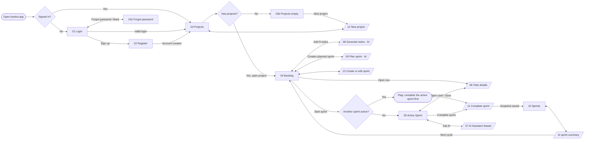

# Kanbot — DESIGN.md

> Frontend build spec for **Kanbot**, a sprint board with an AI teammate.
> Audience: the frontend developer (Claude Code). Read this file fully before writing code.
> Source of truth for visuals and behavior: the Kanbot design canvas (prototype `Main.dc.html`, 51 artboards, light + dark).
> Version 1 · 2026-11-02

---

## 0. How to use this file

1. Set up the **tokens** (§3) exactly as given: CSS custom properties on the app root, switched by a `light` / `dark` class.
2. Install **fonts** (§4) and **icons** (§5).
3. Build the **components** (§7) with every state listed, then the **screens** (§9).
4. Wire **motion** (§8), **keyboard + accessibility** (§10) and **states** (§11).
5. Do not invent values. If something is not specified here, reuse the closest token and add a `// TODO(design):` comment.

**Rules**

- Never hard-code a hex color in a component. Use `var(--token)`.
- Use logical CSS properties (`margin-inline`, `padding-inline-start`, `inset-inline-end`, `text-align: start`) everywhere so RTL (Arabic) can be switched on later with `dir="rtl"`.
- Every interactive element has a visible `:focus-visible` ring.
- Every drag-and-drop action also has a keyboard equivalent.
- Respect `prefers-reduced-motion`.

---

## 1. Product overview

Kanbot is a Jira-style sprint tool for small teams. The user creates **projects**, fills a **backlog** with **todos** (Story / Task / Bug), plans **sprints**, runs one **active sprint** on a 4-column board, and completes it. An **AI assistant** (green, always marked as AI) can generate todos from a description, plan a sprint within capacity, answer questions in a side drawer, and write sprint summaries.

**Visual language**

- Atlassian Design System (ADS) tokens and component shapes, as on the current Jira board.
- **Brand color is Kanbot indigo** (`#4F46E5` light / `#818CF8` dark). It replaces Jira blue for primary actions, selection and focus.
- **Green is reserved for AI.** Every AI surface, button and badge uses the `--ai-*` tokens.
- Calm, dense, 8px grid, 14px body text.

---

## 2. Suggested stack

The design doesn't require a specific stack. This fits the developer's usual toolset:

| Concern | Suggestion |
|---|---|
| Framework | React 18 + TypeScript (Vite or Next.js App Router) |
| Styling | CSS variables from §3 + CSS Modules **or** Tailwind mapped to the variables (`bg-[var(--surface)]`, or extend the theme with `colors: { surface: 'var(--surface)' }`) |
| Icons | `@atlaskit/icon` + `@atlaskit/icon-lab` (§5) |
| Drag and drop | `@dnd-kit/core` + `@dnd-kit/sortable` (has keyboard sensors and screen-reader announcements built in) |
| Server state | TanStack Query (gives you loading / error / retry / offline states from §11) |
| Forms | React Hook Form + Zod (limits in §12) |
| Dialogs and menus | Radix UI primitives (unstyled), styled with the tokens; or hand-rolled with the focus rules in §10 |
| Dates | `date-fns` |

---

## 3. Design tokens

### 3.1 Theme setup

```html
<html class="light">   <!-- or "dark"; persist the user's choice; default to prefers-color-scheme -->
```

When the theme toggles, add a `theming` class to the root for 300ms so colors cross-fade, then remove it:

```css
.theming, .theming * {
  transition: background-color 300ms var(--ease-practical), color 300ms var(--ease-practical),
              border-color 300ms var(--ease-practical), box-shadow 300ms var(--ease-practical) !important;
}
```

### 3.2 Color tokens (copy as-is)

```css
.light {
  --surface:#FFFFFF; --surface-hovered:#F0F1F2; --surface-pressed:#DDDEE1; --surface-sunken:#F8F8F8; --surface-raised:#FFFFFF; --surface-overlay:#FFFFFF;
  --text:#292A2E; --text-subtle:#505258; --text-subtlest:#6B6E76; --text-inverse:#FFFFFF;
  --brand:#4F46E5; --brand-hover:#4338CA; --brand-pressed:#3730A3; --text-brand:#4338CA;
  --selected:#EEF2FF; --selected-hover:#E0E7FF; --selected-pressed:#C7D2FE; --text-selected:#4338CA; --border-selected:#4F46E5;
  --neutral:#0515240F; --neutral-hover:#0B120E24; --neutral-pressed:#080F214A;
  --border:#0B120E24; --border-input:#8C8F97; --input:#FFFFFF; --input-hover:#F8F8F8; --focus:#6366F1;
  --shadow-raised:0px 1px 1px #1E1F2140, 0px 0px 1px #1E1F214F;
  --shadow-overlay:0px 8px 12px #1E1F2126, 0px 0px 1px #1E1F214F;
  --blanket:#050C1F75; --drop:#4F46E514;
  --ai-bg:#DCFFF1; --ai-bg-hover:#BAF3DB; --ai-bg-pressed:#7EE2B8; --ai-fg:#164B35; --ai-icon:#22A06B; --ai-border:#7EE2B8;
  --danger:#AE2E24; --danger-icon:#C9372C; --danger-bg:#FFECEB; --danger-border:#E2483D;
  --warning-icon:#E06C00; --warning-bg:#FFF5DB; --warning-fg:#693200;
  --info-icon:#357DE8; --success:#4C6B1F; --success-icon:#22A06B;
  --t-story:#6A9A23; --t-bug:#C9372C; --t-task:#4688EC;
  --progress:#0515240F; --progress-done:#4F46E5;
  --lz-blue-bg:#CFE1FD; --lz-blue-fg:#123263; --lz-purple-bg:#EED7FC; --lz-purple-fg:#48245D;
  --lz-green-bg:#BAF3DB; --lz-green-fg:#164B35; --lz-orange-bg:#FCE4A6; --lz-orange-fg:#693200;
  --lz-teal-bg:#C6EDFB; --lz-teal-fg:#164555; --lz-magenta-bg:#FDD0EC; --lz-magenta-fg:#50253F;
  --lz-gray-bg:#DDDEE1; --lz-gray-fg:#1E1F21;
  --av-1:#4F46E5; --av-2:#1F845A; --av-3:#AE4787; --av-4:#BD5B00; --av-fg:#FFFFFF;
  --flag:#292A2E; --flag-fg:#FFFFFF;
}
.dark {
  --surface:#1F1F21; --surface-hovered:#242528; --surface-pressed:#303134; --surface-sunken:#18191A; --surface-raised:#242528; --surface-overlay:#2B2C2F;
  --text:#CECFD2; --text-subtle:#A9ABAF; --text-subtlest:#96999E; --text-inverse:#1F1F21;
  --brand:#818CF8; --brand-hover:#A5B4FC; --brand-pressed:#C7D2FE; --text-brand:#A5B4FC;
  --selected:#25274A; --selected-hover:#2F3263; --selected-pressed:#3A3F7A; --text-selected:#A5B4FC; --border-selected:#818CF8;
  --neutral:#CECED912; --neutral-hover:#E3E4F21F; --neutral-pressed:#E5E9F640;
  --border:#E3E4F21F; --border-input:#7E8188; --input:#242528; --input-hover:#2B2C2F; --focus:#A5B4FC;
  --shadow-raised:0px 0px 0px 1px #00000000, 0px 1px 1px #01040480, 0px 0px 1px #01040480;
  --shadow-overlay:0px 0px 0px 1px #BDBDBD1F, 0px 8px 12px #0104045C, 0px 0px 1px 1px #01040480;
  --blanket:#10121499; --drop:#818CF81F;
  --ai-bg:#1C3329; --ai-bg-hover:#164B35; --ai-bg-pressed:#216E4E; --ai-fg:#BAF3DB; --ai-icon:#2ABB7F; --ai-border:#216E4E;
  --danger:#FD9891; --danger-icon:#F15B50; --danger-bg:#42221F; --danger-border:#F15B50;
  --warning-icon:#FBC828; --warning-bg:#3A2C1F; --warning-fg:#FCE4A6;
  --info-icon:#4688EC; --success:#B3DF72; --success-icon:#2ABB7F;
  --t-story:#82B536; --t-bug:#F15B50; --t-task:#4688EC;
  --progress:#CECED912; --progress-done:#818CF8;
  --lz-blue-bg:#123263; --lz-blue-fg:#CFE1FD; --lz-purple-bg:#48245D; --lz-purple-fg:#EED7FC;
  --lz-green-bg:#164B35; --lz-green-fg:#BAF3DB; --lz-orange-bg:#693200; --lz-orange-fg:#FCE4A6;
  --lz-teal-bg:#164555; --lz-teal-fg:#C6EDFB; --lz-magenta-bg:#50253F; --lz-magenta-fg:#FDD0EC;
  --lz-gray-bg:#4B4D51; --lz-gray-fg:#E2E3E4;
  --av-1:#818CF8; --av-2:#4BCE97; --av-3:#E774BB; --av-4:#FCA700; --av-fg:#1F1F21;
  --flag:#CECFD2; --flag-fg:#1F1F21;
}
```

### 3.3 Token meaning (what to use where)

| Token | ADS equivalent | Use for |
|---|---|---|
| `--surface` | elevation.surface | Page, sidebar, header |
| `--surface-sunken` | elevation.surface.sunken | Board columns, backlog groups, stat tiles |
| `--surface-raised` | elevation.surface.raised | Cards, backlog rows, project tiles |
| `--surface-overlay` | elevation.surface.overlay | Dialogs, menus, drawer |
| `--surface-hovered` / `-pressed` | elevation.surface.hovered / pressed | Row and card hover / press |
| `--text` / `-subtle` / `-subtlest` | color.text / subtle / subtlest | Primary · secondary and nav · meta, placeholder, help |
| `--text-inverse` | color.text.inverse | Text on brand buttons |
| `--brand` (+ `-hover`, `-pressed`) | background.brand.bold* | Primary button, progress fill, user chat bubble, active nav bar |
| `--text-brand` | color.link* | Links, row title hover |
| `--selected` (+ `-hover`, `-pressed`), `--text-selected`, `--border-selected` | background.selected* | Active nav item, selected sprint, radio card, drop target outline |
| `--focus` | border.focused* | Focus ring, focused input border, composer ring |
| `--neutral` (+ `-hover`, `-pressed`) | background.neutral | Neutral buttons, chips, pills, skeleton base |
| `--border` | color.border | Dividers, outlines |
| `--border-input` | color.border.input | Input / select borders |
| `--drop` | — | Drop target fill, input focus halo |
| `--blanket` | color.blanket | Behind dialogs and drawer |
| `--ai-*` | accent.green family | **Only** AI surfaces, AI buttons, AI icon, AI live dot |
| `--danger*` | danger family | Errors, destructive actions, overdue, High priority |
| `--warning-*` | warning family | Offline banner, unsaved-changes bar, Medium priority |
| `--success-icon` | icon.success | Done check |
| `--t-story` / `--t-task` / `--t-bug` | — | Work-type icon colors |
| `--lz-<hue>-bg/-fg` | accent subtler / bolder | Lozenges and project avatars |
| `--av-1…4` + `--av-fg` | — | User avatar backgrounds (assign by user index mod 4) |
| `--flag` / `--flag-fg` | — | Toast (inverse surface) |
| `--progress` / `--progress-done` | — | Progress bar track / fill |

`*` = brand tokens recoloured from Jira blue to Kanbot indigo.

**Lozenge mapping**: Planned → gray · Active → blue (with pulsing dot) · Completed → green · Project key → gray.
**Board column dots**: To Do gray, In Progress blue, In Review purple, Done green (use `--lz-<hue>-fg` as the dot color).

### 3.4 Spacing

8px base (ADS `space-*`).

| Token | px | Use |
|---|---|---|
| space-050 | 4 | Icon to small text, label to input |
| space-075 | 6 | Chip gaps, menu padding |
| space-100 | 8 | Default gap, card list gap |
| space-150 | 12 | Card padding, button horizontal padding |
| space-200 | 16 | Field gaps, mobile page gutter |
| space-250 | 20 | Dialog body top |
| space-300 | 24 | Dialog padding, section gap |
| space-400 | 32 | Desktop page gutter |

### 3.5 Radius, elevation, fixed sizes

| Name | Value | Use |
|---|---|---|
| radius-small | 4px | Lozenges, chips, kbd |
| radius-medium | 6px | Buttons, inputs, nav items, menu items |
| radius-large | 8px | Columns, groups, menus, banners, radio cards |
| radius-xlarge | 12px | Cards, project tiles, dialogs, auth card, composer |
| radius-full | 999px | Avatars, pills, chat chips, progress bars |
| shadow-raised | `--shadow-raised` | Cards and rows at rest |
| shadow-overlay | `--shadow-overlay` | Card hover, menus, dialogs, drawer |
| Button | 32px (lg 40px; icon-only 32×32) | |
| Input / select | 36px | |
| Chip button (AI quick prompts) | 28px | |
| Page header | 64px | |
| Backlog row | 44px | |
| Sidebar | 240px | |
| AI drawer | 440px (100% on mobile) | |
| Board column | min 232px; board min-width 980px | |
| Auth card | max 420px | |
| Mobile top bar | 56px | |

**Dialog max widths**

| Dialog | Max width |
|---|---|
| Session expired | 420px |
| Complete sprint | 480px |
| Create / edit sprint | 520px |
| New project | 560px |
| Todo details | 880px |
| Generate todos | 920px |
| Plan sprint | 960px |

---

## 4. Typography

```html
<link href="https://fonts.googleapis.com/css2?family=Inter:wght@400;500;600;700&family=IBM+Plex+Sans+Arabic:wght@400;500;600;700&display=swap" rel="stylesheet">
```

```css
.app {
  font-family: Inter, "IBM Plex Sans Arabic", ui-sans-serif, -apple-system, "Segoe UI", sans-serif;
  font-size: 14px; line-height: 20px;
  -webkit-font-smoothing: antialiased;
}
```

- **Inter** handles Latin text. **IBM Plex Sans Arabic** is the Arabic fallback in the same stack, so Arabic user content renders correctly today. A full RTL layout is not designed yet (§14).
- In Next.js you can use `next/font/google` for both fonts with `display: 'swap'`.

| Style | Size / line-height / weight | Extra | Used for |
|---|---|---|---|
| `page-title` | 24 / 28 / 700 | letter-spacing −0.2px | Page h1 |
| `dialog-title` | 20 / 24 / 700 | | Dialog h2, section h2 |
| `group-title` | 16 / 20 / 700 | | Backlog group, h3 |
| `body` | 14 / 20 / 400 | buttons 500 | Default text, inputs |
| `label` | 12 / 16 / 600 | color `--text-subtle` | Field labels |
| `meta` | 12 / 16 / 400–600 | | Keys (600), dates, help text |
| `lozenge` | 11 / 20 / 700 | uppercase, +0.2px | Lozenges; column titles are 12px |
| `metric` | 28 / 32 / 700 | | Stat tiles |

Card titles wrap; clamp at 3 lines. Backlog rows, lists and menus use a single line with an ellipsis.

---

## 5. Icons

### 5.1 Source

Use the Atlassian icon packages (the same set the Jira board uses). Do **not** use Atlassian product logos (Jira, Assets, Teams, roadmap tiles).

```bash
npm i @atlaskit/icon @atlaskit/icon-lab
```

Icons render as SVG with `fill="currentColor"`, so they take the text color of their parent. Sizes: **16px** default, **12px** inside chips and meta, **20–24px** in empty states.

Two ways to use them:

- **(a) React components.** Simplest. Each icon needs a `label` prop: an empty string when decorative, a real label when the icon stands alone.
  ```tsx
  import AddIcon from '@atlaskit/icon/core/add';
  <AddIcon label="" />
  ```
- **(b) Your own `<Icon name>` wrapper.** Gives full control over size and color tokens. Copy the `<path d>` from `node_modules/@atlaskit/icon/core/<name>.js` (or `icon-lab/core/<name>.js`) into an `icons.ts` map, and render `<svg viewBox="0 0 16 16" fill="none"><path fill="currentColor" d={...}/></svg>`. This is what the prototype does.

### 5.2 Icon inventory

| Name in design | Package import | Where |
|---|---|---|
| add | `@atlaskit/icon/core/add` | Create buttons, new project tile, Create todo |
| search | `@atlaskit/icon/core/search` | Search fields |
| backlog | `@atlaskit/icon/core/backlog` | Nav: Backlog |
| board | `@atlaskit/icon/core/board` | Nav: Active Sprint |
| sprint | `@atlaskit/icon/core/sprint` | Nav: Sprints, sprint lists |
| spaces | `@atlaskit/icon-lab/core/spaces` | Nav: Projects |
| show-more-horizontal | `@atlaskit/icon/core/show-more-horizontal` | ⋯ menus on rows, tiles, columns |
| chevron-down | `@atlaskit/icon/core/chevron-down` | Selects, collapsible groups (rotate −90° collapsed), switcher |
| cross | `@atlaskit/icon/core/cross` | Close dialog / drawer, remove label, clear search |
| drag-handle-vertical | `@atlaskit/icon/core/drag-handle-vertical` | Backlog row handle |
| check-mark | `@atlaskit/icon/core/check-mark` | Selected menu item, copied state |
| check-circle | `@atlaskit/icon/core/check-circle` | Done todos, success toast |
| calendar | `@atlaskit/icon/core/calendar` | Sprint dates, due date |
| log-out | `@atlaskit/icon/core/log-out` | Profile menu |
| theme | `@atlaskit/icon/core/theme` | Light / dark toggle |
| ai-sparkle | `@atlaskit/icon/core/ai-sparkle` | **Every** AI action and surface (rotates 18° and scales 1.1 on hover) |
| delete | `@atlaskit/icon/core/delete` | Delete todo / project |
| send | `@atlaskit/icon/core/send` | Chat composer |
| refresh | `@atlaskit/icon/core/refresh` | Regenerate, Try again, Retry |
| lightbulb | `@atlaskit/icon/core/lightbulb` | AI tips, sprint summary insights |
| status-error | `@atlaskit/icon/core/status-error` | Error messages, banners, page error |
| status-warning | `@atlaskit/icon/core/status-warning` | Over capacity, unsaved changes, overdue |
| warning-outline | `@atlaskit/icon-lab/core/warning-outline` | Offline banner |
| arrow-right / arrow-left | `@atlaskit/icon/core/arrow-right`, `arrow-left` | Move actions, back links |
| priority-high / -medium / -low | `@atlaskit/icon/core/priority-high`, `priority-medium`, `priority-low` | Priority chip. Colors: `--danger-icon`, `--warning-icon`, `--info-icon` |
| bug | `@atlaskit/icon/core/bug` | Bug work type, color `--t-bug` |
| pencil | `@atlaskit/icon-lab/core/pencil` | Edit sprint, edit title |
| menu | `@atlaskit/icon/core/menu` | Mobile hamburger |
| copy | `@atlaskit/icon/core/copy` | Copy drafts in AI chat |
| email | `@atlaskit/icon/core/email` | Forgot password "check your email" |
| lock-locked | `@atlaskit/icon/core/lock-locked` | Session expired dialog |

Versions used in the design: `@atlaskit/icon@38.0.2` and `@atlaskit/icon-lab@7.11.0`.

### 5.3 Custom work-type icons (Task, Story)

These come from the Jira board, not the icon package. Use them as-is, with the hard-coded fill swapped for `currentColor`. Set the color through `--t-task` / `--t-story`.

```html
<!-- Task (color: var(--t-task)) -->
<svg width="16" height="16" viewBox="0 0 16 16" fill="none" role="img" aria-label="Task"><path fill="currentColor" fill-rule="evenodd" clip-rule="evenodd" d="m1 3c0-1.10457.89543-2 2-2h10c1.1046 0 2 .89543 2 2v10c0 1.1046-.8954 2-2 2h-10c-1.10457 0-2-.8954-2-2zm2-.5c-.27614 0-.5.22386-.5.5v10c0 .2761.22386.5.5.5h10c.2761 0 .5-.2239.5-.5v-10c0-.27614-.2239-.5-.5-.5zm9.3262 2.98014-5.00003 5.99996c-.1425.171-.35359.2699-.57617.2699s-.43367-.0989-.57617-.2699l-2.5-2.99996 1.15234-.96028 1.92383 2.3086 4.4238-5.3086z"/></svg>

<!-- Story (color: var(--t-story)) -->
<svg width="16" height="16" viewBox="0 0 16 16" fill="none" role="img" aria-label="Story"><path fill="currentColor" fill-rule="evenodd" clip-rule="evenodd" d="m4.98291 2.5c-.27614 0-.5.22386-.5.5v9.8059l3.51724-2.4727 3.51775 2.4728v-9.806c0-.27614-.2239-.5-.5-.5zm-2 .5c0-1.10457.89543-2 2-2h6.03499c1.1046 0 2 .89543 2 2v11.25c0 .2799-.1559.5366-.4043.6656s-.548.109-.777-.052l-3.8364-2.6968-3.83595 2.6968c-.229.1609-.5286.181-.77702.052-.24843-.129-.40432-.3857-.40432-.6656z"/></svg>
```

Work-type icons that appear alone are `role="img"` with an `aria-label`. All other icons next to text get `aria-hidden="true"`.

### 5.4 Logo

The Kanbot logo is a robot head whose face is a mini kanban board. Sizes: 36px on the auth card, 28px in the sidebar, 24px in the mobile bar.

The logo stays the same in both themes. Use the supplied files `kanbot-icon.svg`, `kanbot-logo.svg`, `kanbot-logo-dark.svg` and `kanbot-logo-tagline.svg`, or this inline mark:

```html
<svg width="28" height="28" viewBox="0 0 512 512" aria-hidden="true"><rect width="512" height="512" rx="112" fill="#4F46E5"/><rect x="248" y="100" width="16" height="60" rx="8" fill="#FFFFFF"/><circle cx="256" cy="94" r="26" fill="#22C55E"/><rect x="78" y="232" width="44" height="88" rx="16" fill="#FFFFFF"/><rect x="390" y="232" width="44" height="88" rx="16" fill="#FFFFFF"/><rect x="104" y="148" width="304" height="252" rx="68" fill="#FFFFFF"/><rect x="144" y="190" width="224" height="168" rx="40" fill="#4F46E5"/><rect x="176" y="220" width="40" height="108" rx="12" fill="#FFFFFF"/><rect x="236" y="220" width="40" height="76" rx="12" fill="#FFFFFF"/><rect x="296" y="220" width="40" height="46" rx="12" fill="#22C55E"/></svg>
```

The wordmark next to the mark reads "Kanbot" in 18/24/700, color `--text`.

---

## 6. App layout (shell)

```
┌───────────────┬──────────────────────────────────────────────────────────┐
│ Sidebar 240px │ Page header 64px: h1 · meta · actions (Ask AI, primary)  │
│  logo         ├──────────────────────────────────────────────────────────┤
│  project      │                                                          │
│  switcher     │  <main id="main"> page content, padding 0 32px 32px      │
│  ── nav ──    │                                                          │
│  Projects     │                                                          │
│  Backlog      │                                                          │
│  Active Sprint│                                                          │
│  Sprints      │                                                          │
│  ── bottom ── │                                                          │
│  theme toggle │                                                          │
│  profile menu │                                                          │
└───────────────┴──────────────────────────────────────────────────────────┘
       Toast: bottom-left (inline-start), 24px from the edges
       AI drawer: right (inline-end), 440px, over a blanket
```

**Sidebar**

- Background `--surface`, with a 1px `--border` on the inline-end side.
- Padding 16px 12px.
- **Project switcher.** A 36px button with a 24px project avatar (letter on `--lz-<hue>-bg`), the project name, the key, and a chevron. It opens a menu that lists the projects, then "View all projects".
- **Nav item.** 36px tall, radius 6, gap 10, icon 16.
  - Hover: `--neutral`, and the icon nudges 1px.
  - Active: `--selected` background with `--text-selected` text at weight 600, `aria-current="page"`, plus a 3px brand bar on the inline-start edge that animates in.
- The Backlog, Active Sprint and Sprints items need a current project.

**Top**

- The first Tab stop is a "Skip to main content" link. It is hidden above the viewport and slides to `top: 12px` on focus.
- A full-width offline banner sits above the shell when it is active (§11).

---

## 6b. User flow and routing

The canvas board "00b User flow and journey" draws this as a lane flowchart, with a journey map underneath. Below is the same flow as Mermaid; use it to set up routes, guards and overlays.



**Routes and guards**

| Route | Screen | Guard / notes |
|---|---|---|
| `/login`, `/register`, `/forgot-password` | 01, 02, 01b | Public. Redirect to `/projects` when already signed in |
| `/projects` | 03 / 03b | Auth required. Empty state when the user has no projects |
| `/projects/:key/backlog` | 04 | Auth required + project exists (else 404) |
| `/projects/:key/board` | 05 | Shows the "No active sprint" empty state when no sprint is active |
| `/projects/:key/sprints/:sprintId?` | 10 | Defaults to the most recent sprint |
| `?todo=KAN-18` (query on backlog or board) | 06 modal | Deep-linkable; closing removes the param; unknown key → 404 |
| Overlays without routes | 07, 08, 09, 11, 12, 13 | Opened from buttons; not deep-linked (optional `?dialog=` if needed) |
| `*` | 404 | Unknown routes, missing project or todo |

**Global rules**

- Sidebar navigation (Projects, Backlog, Active Sprint, Sprints) is available on every signed-in screen. The project-scoped items need a current project.
- The AI drawer can open from any signed-in screen and keeps its chat.
- Any API 401 after login opens the Session expired dialog, which leads to `/login`.
- On every route change, show the skeleton (§11); on failure, show the page error.
- **Only one active sprint per project.** "Start sprint" is blocked while another sprint is active.

**Journey (one sprint cycle)**

1. Get in.
2. Set up a project.
3. Fill the backlog (AI drafts).
4. Plan the sprint (AI picks within capacity).
5. Run the sprint on the board.
6. Close and review (AI summary).
7. Loop back to step 3.

---

## 7. Components

All transitions use the motion tokens (§8). `:active` scale applies only when the element is not disabled.

### Button

```
height 32 (lg 40) · padding 0 12 · radius 6 · 14/500 · gap 6 · icon 16
```

| Variant | Rest | Hover | Pressed |
|---|---|---|---|
| primary | `--brand` / `--text-inverse` | `--brand-hover` | `--brand-pressed` |
| neutral | `--neutral` / `--text-subtle` | `--neutral-hover` | `--neutral-pressed` |
| subtle | transparent / `--text-subtle` | `--neutral` | `--neutral-hover` |
| ai | `--ai-bg` / `--ai-fg`, with the ai-sparkle icon | `--ai-bg-hover`; icon rotates 18° and scales 1.1 | `--ai-bg-pressed` |
| danger | transparent / `--danger` | `--danger-bg` | — |
| icon-only | 32×32, padding 0, any variant; **must have `aria-label`** | | |

- All variants: pressed `transform: scale(.97)` over 100ms.
- Disabled: `opacity .6`, `cursor: not-allowed`.
- **Loading:** a spinner (14px ring, 2px border, `border-right-color: transparent`, spins in 700ms linear) plus a verb ("Saving…", "Creating…"). The button is disabled and keeps its width.
- Only one primary button per region.

### Chip button (AI quick prompts)

- 28px tall, pill shape, 1px `--border`, 12/500, color `--text-subtle`.
- Hover: `--neutral` fill and a `--border-input` border.
- Pressed: scale .96.

### Text field / textarea / select / date

- **Label:** 12/16/600 in `--text-subtle`, 4px above the field. Required fields end with ` *`.
- **Field:** 36px tall, padding 0 12, 1px `--border-input`, radius 6, `--input` background.
  - Hover: `--input-hover`.
  - Focus: `--focus` border, plus `inset 0 0 0 1px var(--focus), 0 0 0 3px var(--drop)`.
  - Placeholder: `--text-subtlest`.
- **Error:** `--danger-border` border, `aria-invalid="true"`, and the message below it: 12/16 in `--danger`, status-error icon at 12px, linked by `aria-describedby`. The message plays the shake animation when it appears.
- **Help text:** 12/16 in `--text-subtlest`.
- **Textarea:** padding 8 12, resize vertical.
- **Select:** a native `<select>` with `appearance: none`, the chevron-down icon placed at inline-end 10px, padding-inline-end 32. Disabled: `.6`.
- **Date:** a native `type=date` with its picker indicator hidden and the calendar icon on top. Set `color-scheme` to light or dark to match the theme.
- **Checkbox / radio:** native 16px controls with `accent-color: var(--brand)`.
- **Tag input (labels):** looks like a field, with chips inside and a borderless input. Focus ring on `:focus-within`.

### Todo card (board)

- The whole card is a `<button>`.
- Surface `--surface-raised`, `--shadow-raised`, radius 12, padding 12, gap 10.
- Anatomy, top to bottom:
  1. Title (14/20, max 3 lines).
  2. Chip row: type chip with icon, priority chip, overdue chip (danger) when it applies, labels.
  3. Footer: key (12/600 in `--text-subtle`; Done cards show a `--success-icon` check-circle), points pill, assignee avatar (24px).

| State | Style |
|---|---|
| Hover | `translateY(-2px)`, `--shadow-overlay` |
| Pressed | `scale(.985)`, `--surface-pressed`, cursor grabbing |
| Focus-visible | Focus ring plus the hover lift |
| Dragging (source) | opacity .35, scale .97, no shadow |
| Just dropped / moved by keyboard | `kbDrop` 900ms: brand ring and 1.04 → 1 scale |
| Dimmed (filtered out) | opacity .45 |

### Board column

- `--surface-sunken`, radius 8, padding 8, gap 8.
- Header: status dot, title (12/16/700, uppercase), count pill, then total points on the inline-end side.
- `role="region"`, `aria-label="In Progress, 3 todos"`.
- **Drag over:** `--drop` fill plus `inset 0 0 0 2px var(--border-selected)`.
- **Empty:** a dashed 1px `--border` box that says "Drop todos here".
- **Footer:** a subtle "Create todo" button. It turns into the **composer**: a raised card with a 2px `--focus` ring and a textarea. Enter adds the todo and keeps the composer open, Shift+Enter adds a new line, Esc cancels.

### Backlog group and row

- **Group:** `--surface-sunken`, radius 8.
  - Header: collapse chevron (rotates −90° when collapsed, 200ms), title (16/700), lozenge, dates, count, points.
  - Actions on the inline-end side: Start sprint, or ⋯.
  - Drag-over style is the same as a board column.
  - Empty sprint: "Drag todos here to plan Sprint X".
- **Row:** 44px tall, a top 1px border, `--surface-raised`. Grid columns:
  ```
  16px (drag) · 16px (type) · 64px (key) · 1fr (title) · 96px (priority) · 52px (points) · 32px (⋯)
  ```
  - Hover `--surface-hovered`; pressed `--surface-pressed`; while its menu is open it keeps the hover background.
  - The title is a button: single line with an ellipsis. Hover turns it `--text-brand` and underlined.
  - New or moved rows play `kbAdded`: a rise plus a `--selected` highlight that fades out over 1.3s.
- **Inline create** at the bottom of the backlog: a "+ Create" field. Enter creates a Task.

### Lozenge

- 20px tall, padding 0 6, radius 4, 11/700, uppercase, +0.2px.
- Colors come from `--lz-<hue>-bg/-fg`.
- The Active lozenge has a 6px dot that pulses (`kbPulse`, 2s, infinite).

### Chip / pill

- **Chip:** 22px tall, radius 4, `--neutral` background, 12/500 in `--text-subtle`, gap 6, icon 12.
- **Points pill:** min-width 20, 20px tall, pill shape, 12/600.
- **Label chip** (in the todo dialog): has a × button with `aria-label="Remove label X"`.

### Avatar

- 24 / 28 / 32px, round, initials at 700 in `--av-fg` on `--av-N`.
- Hover: scale 1.12 over 250ms with `cubic-bezier(.34,1.56,.64,1)` (spring).
- Unassigned: a dashed outline circle.

### Project tile (Projects page)

- `--surface-raised`, radius 12, `--shadow-raised`.
- Contents: project avatar (letter), name, key lozenge, description (2 lines), progress bar, sprint and todo counts, ⋯ menu.
- The whole tile is clickable using the stretched-link technique (an `::after` covering the tile). The ⋯ button sits above it with `z-index: 1`.
- Hover: `translateY(-3px)` and `--shadow-overlay`. Pressed: scale .99.
- **New-project tile:** dashed border. On hover it fills with `--selected` and its text turns `--text-selected`.

### Sprint list item (Sprints page)

- Padding 14 16, radius 8, a 2px transparent border.
- Hover: `translateX(3px)` and the overlay shadow.
- Selected: `--selected` background with a `--border-selected` border.

### Stat tile

- `--surface-sunken`, radius 8, padding 14 16.
- Label 12 in `--text-subtlest`; value 28/32/700.
- Hover: lift 2px.

### Progress bar

- 6–8px tall, pill shape, track `--progress`, fill `--progress-done`.
- The width transitions over 500ms with inout-bold.
- **Over capacity** (Plan sprint): the fill and the total turn `--danger-icon`.

### Menu (popover)

- At least 200px wide, padding 6, radius 8, `--surface-overlay`, `--shadow-overlay`, gap 2.
- Item: at least 36px tall, padding 0 10, radius 6, 13px, icon 16, gap 10.
  - Hover and focus: `--neutral`. Pressed: `--neutral-hover`.
  - Danger item: text `--danger`.
- Separator: 1px `--border`, margin 4 2.
- Opens with `kbPop` (150ms).
- `role="menu"` with `menuitem` children.
- The first item is focused on open; ↑, ↓, Home and End move between items; Esc or an outside click closes the menu and returns focus to the trigger.

### Dialog

- A blanket (`--blanket`, fades in) behind a centered panel.
- Panel: `--surface-overlay`, radius 12, `--shadow-overlay`, max widths per §3.5, max height `calc(100vh - 64px)`.
- **Header:** padding 24 24 0, h2 plus a close icon button.
- **Body:** scrolls; padding 20 24.
- **Footer:** padding 16 24 24. Secondary actions sit on the inline-start side (for example Delete); Cancel and the primary action sit on the inline-end side.
- `role="dialog"`, `aria-modal="true"`, `aria-labelledby` pointing at the title.
- Focus behavior is in §10.

### AI drawer

- `role="dialog"`, aria-label "Kanbot Assistant".
- 440px wide, full height, on the inline-end side, slides in. The blanket sits behind it.
- **Header:** ai-sparkle in `--ai-icon`, the title "Kanbot Assistant", the subtitle "AI can make mistakes", a "New chat" button and a close button.
- **Quick prompts:** chip buttons. Examples: "What's blocking Sprint 3?", "Summarize this sprint", "Generate todos for…".
- **Log:** `role="log"`, `aria-live="polite"`.
  - User bubble: `--brand` / `--text-inverse`, radius 12, aligned to the inline-end side.
  - AI bubble: `--ai-bg` / `--ai-fg`, aligned to the inline-start side. It can hold an action button (for example "Add 3 todos to Backlog") and a Copy button.
  - Thinking: three 6px `--ai-icon` dots that bounce (`kbDot` 1.2s, staggered 0.2s).
  - Empty chat: an illustration and example prompts.
- **Composer:** a textarea plus the send icon button. Enter sends; Shift+Enter adds a new line.
- The chat persists between opens; "New chat" resets it.

### Flag (toast)

- Fixed at the bottom-left (inline-start), 24px from the edges.
- `--flag` background, `--flag-fg` text, radius 8, `--shadow-overlay`, padding 12 16.
- Contents: check-circle icon in `--success-icon`, the message, and an optional action link (Undo, Complete Sprint 3).
- `role="status"`.
- Auto-hides after 3.2s, or after **5s when it has an action**.
- Enter animation `kbFlagIn`; exit `kbFlagOut`.
- One toast at a time; a new one replaces the old one.

### Skeleton

- A `--neutral` block, radius 6, with a shimmering gradient (`kbShimmer`, 1.2s, infinite).
- The skeleton copies the real layout: columns with cards, groups with rows, tiles, or a list next to a panel.
- The real page title stays visible above it.
- Container: `role="status"`, `aria-busy="true"`, plus an sr-only "Loading <page>".

### Banner and confirm bar

- **Banner:** full width, padding 8 16, 13/500, gap 10.
  - Offline: `--warning-bg` / `--warning-fg`, warning-outline icon, and a "Retry now" button that shows a spinner while it runs.
  - Save error: `--danger-bg` / `--danger`.
- **Unsaved-changes confirm bar** (Todo dialog, above the footer):
  - `--warning-bg`, radius 8, `role="alertdialog"`.
  - Text: "Discard unsaved changes?"
  - Buttons: "Keep editing" (focused on open) and "Discard" (danger).

---

## 8. Motion

### 8.1 Easing tokens

```css
:root {
  --ease-practical: cubic-bezier(0.4, 1, 0.6, 1);  /* buttons, inputs, menus  (ADS out-practical) */
  --ease-bold:      cubic-bezier(0, 0.4, 0, 1);    /* pages, drawer, entries  (ADS out-bold)      */
  --ease-in:        cubic-bezier(0.6, 0, 0.8, 0.6);/* exits                   (ADS in-practical)  */
  --ease-inout:     cubic-bezier(0.4, 0, 0, 1);    /* dialogs, progress, rotations (ADS inout-bold) */
}
```

### 8.2 Motion table

| Element | Trigger | Animation | Duration | Easing |
|---|---|---|---|---|
| Page | Route change | Fade in, rise 8px | 250ms | bold |
| Cards, rows, tiles | Mount | Fade in, rise 8px; **stagger 45ms per item, 60ms per column** | 300ms | bold |
| Dialog | Open / close | Scale .95 → 1 with fade / reverse | 250 / 200ms | inout / in |
| Blanket | Open / close | Fade | 250 / 200ms | linear |
| Drawer | Open / close | Slide from `translateX(100%)` | 250 / 200ms | bold |
| Menu, popover, inline hint | Open | Fade, drop from −8px, scale .98 | 150ms | practical |
| Flag | Show / hide | Slide from −50% X with fade / slide −15% with fade | 250 / 200ms | bold / in |
| Dropped card | Drop or keyboard move | Scale 1.04 → 1 with a 2px brand ring | 900ms | bold |
| New or moved row | Create / move | Rise, plus a `--selected` highlight that fades out | 1300ms | bold |
| Error message | Validation fails | Horizontal shake, 6px decaying | 420ms (100ms delay) | practical |
| Nav active bar | Active item changes | `scaleY` 0 → 1 | 250ms | bold |
| Progress bar | Data change | Width transition | 500ms | inout |
| Collapse chevron | Toggle | Rotate −90° | 200ms | inout |
| Theme switch | Toggle | Color, background, border and shadow cross-fade | 300ms | practical |
| Active sprint dot | Always | Pulse ring 0 → 6px | 2s loop | practical |
| AI thinking | Waiting | Three dots bounce 3px, 0.2s offset | 1.2s loop | default |
| Spinner | Loading | Rotate 360° | 700ms loop | linear |
| Hover lifts | Hover | Card −2px, tile −3px, sprint item +3px X | 150ms | practical |
| Pressed | `:active` | Button .97, card .985, chip .96, tile .99 | 100–150ms | practical |

### 8.3 Keyframes

Copy these as-is:

```css
@keyframes kbRise     { from { opacity:0; transform:translateY(8px) } to { opacity:1; transform:none } }
@keyframes kbFade     { from { opacity:0 } to { opacity:1 } }
@keyframes kbFadeOut  { from { opacity:1 } to { opacity:0 } }
@keyframes kbModalIn  { from { opacity:0; transform:scale(.95) } to { opacity:1; transform:none } }
@keyframes kbModalOut { from { opacity:1; transform:none } to { opacity:0; transform:scale(.95) } }
@keyframes kbDrawerIn { from { transform:translateX(100%) } to { transform:none } }
@keyframes kbDrawerOut{ from { transform:none } to { transform:translateX(100%) } }
@keyframes kbPop      { from { opacity:0; transform:translateY(-8px) scale(.98) } to { opacity:1; transform:none } }
@keyframes kbFlagIn   { from { opacity:0; transform:translateX(-50%) } to { opacity:1; transform:none } }
@keyframes kbFlagOut  { from { opacity:1; transform:none } to { opacity:0; transform:translateX(-15%) } }
@keyframes kbBar      { from { transform:scaleY(0) } to { transform:scaleY(1) } }
@keyframes kbDrop     { 0% { transform:scale(1.04); box-shadow:0 0 0 2px var(--brand), var(--shadow-overlay) }
                        60% { box-shadow:0 0 0 2px var(--brand), var(--shadow-raised) }
                        100% { transform:none; box-shadow:var(--shadow-raised) } }
@keyframes kbAdded    { 0% { opacity:0; transform:translateY(8px); background:var(--selected) }
                        25% { opacity:1; transform:none; background:var(--selected) }
                        100% { background:var(--surface-raised) } }
@keyframes kbShake    { 0%,100% { transform:none } 20% { transform:translateX(-6px) } 40% { transform:translateX(5px) }
                        60% { transform:translateX(-3px) } 80% { transform:translateX(2px) } }
@keyframes kbPulse    { 0% { box-shadow:0 0 0 0 var(--ai-border) } 70% { box-shadow:0 0 0 6px transparent } 100% { box-shadow:0 0 0 0 transparent } }
@keyframes kbSpin     { to { transform:rotate(360deg) } }
@keyframes kbShimmer  { to { transform:translateX(100%) } }
@keyframes kbDot      { 0%,80%,100% { opacity:.25; transform:translateY(0) } 40% { opacity:1; transform:translateY(-3px) } }

@media (prefers-reduced-motion: reduce) {
  *, *::before, *::after { animation-duration:1ms !important; animation-iteration-count:1 !important; transition-duration:1ms !important; }
}
```

### 8.4 Implementation notes

- Entry animations use `animation-fill-mode: backwards` so they don't block hover transforms afterwards.
- Exit animations need the element to stay mounted until they finish. Either:
  - add a `closing` class, wait 200ms, then unmount; or
  - use `AnimatePresence` (Framer Motion) with the same durations and easings.
- Mirror the X translations of the drawer and the flag under RTL.

---

## 9. Screens

Each route corresponds to an artboard on the canvas (L = light, D = dark, S = state, M = mobile).

### 01 Login — `/login`

- Centered auth card (max 420px, radius 12, overlay shadow) on `--surface-sunken`.
- Card contents, top to bottom: logo (36px), "Log in to Kanbot", Email, Password, "Forgot password?" link, primary lg button "Log in", "Don't have an account? Sign up".
- **Validation:** on blur and on submit. Email is required and must be a valid format; password is required.
- **401 error:** a danger banner above the fields reading "Incorrect email or password", and the password field is marked invalid. The banner clears as soon as either field is edited.
- **Loading:** "Logging in…".
- Enter submits.

### 01b Forgot password — `/forgot-password`

1. Email field and a "Send reset link" button.
2. Success state: email icon, "Check your email", the address in bold, a Resend link, and "Back to log in".

### 02 Register — `/register`

- Fields: Full name, Email, Password, Confirm password.
- **Password strength meter:** a 4px bar plus a label. Weak → `--danger-icon`, Fair → `--warning-icon`, Strong → `--success-icon`.
- **Validation:**
  - Name: required.
  - Email: valid format.
  - Password: at least 8 characters.
  - Confirm: must match.
- **Submit:** a loading state, then redirect to Projects with a welcome toast.

### 03 Projects — `/projects`

- **Header:** h1 "Projects", search field (filters by name or key), and the primary button "New project".
- **Grid:** `repeat(auto-fill, minmax(280px, 1fr))`, gap 16. Project tiles, then the new-project tile.
- **Tile ⋯ menu:** Open, Edit, Delete. Delete is immediate and shows an Undo toast for 5s.
- **No search results:** "No projects match '<q>'" with a "Clear search" button.
- **Empty (03b):** illustration, "Create your first project", and the "New project" primary button.
- **Newly created project:** gets the `kbAdded` highlight.

### 04 Backlog — `/projects/:key/backlog`

- **Header:** h1 "Backlog", project meta, and the buttons "Generate todos" (ai), "Plan sprint" (ai) and "Create sprint" (neutral).
- **Filter bar:**
  - Search, plus Type, Priority and Assignee selects.
  - "Showing X of Y" with a "Clear filters" link when filters are active.
  - A group with no matches shows "No todos in <group> match your filters".
- **Groups**, in order:
  1. The active sprint, with its Active lozenge and a "Complete sprint" link.
  2. Planned sprints, with a "Start sprint" button.
  3. The Backlog.
- **Rows** follow §7. Moves:
  - Drag between groups.
  - ↑/↓ on a focused row reorders it; at the edge of a group the row moves into the next or previous group.
- **Row ⋯ menu:** Open, "Move to Sprint X", "Move to Backlog", Delete (with Undo).
- **Start sprint rules:**
  - Blocked while another sprint is active. A toast offers "Complete <active sprint>".
  - Blocked when the sprint is empty, with a toast.

### 05 Active Sprint — `/projects/:key/board`

- **Header:**
  - h1 "Active Sprint".
  - Sprint name, dates, and the sprint goal (1 line).
  - Points progress: "13 / 34 pts" with a bar. Done points = points in the Done column (see §14).
  - Buttons: "Ask AI" (ai) and "Complete sprint" (primary).
- **Board:** four columns (To Do, In Progress, In Review, Done), `grid-template-columns: repeat(4, minmax(232px, 1fr))`, gap 12, minimum width 980px with horizontal scroll.
- **Moves:**
  - Drag cards between columns and within a column.
  - Keyboard: ←/→ moves the card to another column, ↑/↓ reorders it.
  - Every move is announced (§10).
- **No active sprint:** empty state with "Go to Backlog" and "Start <next planned sprint>".

### 06 Todo details — modal `?todo=KAN-18`

- 880px dialog in two columns.
- **Main column (left):**
  - Title as an inline-editable input. Required, at most 120 characters.
  - Description textarea.
  - AI suggestion area.
- **Side column (right, 280px):**

| Field | Control and rules |
|---|---|
| Sprint | Select: Backlog / Sprint 3 / Sprint 4 … |
| Status | Select. Enabled only when the todo is in the active sprint; otherwise disabled with help text "Move it into the active sprint to set a status" |
| Priority | Select |
| Type | Select |
| Points | Number, 0–40 |
| Assignee | Select with an avatar |
| Labels | Tag input |
| Due date | Date input. Shows "Overdue by N days" in danger when the date has passed and the todo isn't Done |
| Reporter | Read-only |

- **Footer:**
  - Delete (danger) on the inline-start side.
  - "Unsaved changes" hint while the form is dirty.
  - Cancel and Save on the inline-end side.
- **Saving** can move the todo between the backlog, a planned sprint and a board column in one step.
- **Closing with unsaved changes** (Esc, the close button, the scrim or Cancel) shows the confirm bar instead of closing.
- **Save error:** a danger bar above the footer with Retry. The edits stay in the form.

### 07 AI Assistant — drawer, any screen

Built as described under "AI drawer" in §7. It is opened by "Ask AI" buttons.

### 08 Generate todos — modal over Backlog (920px)

1. A description textarea: required, at most 500 characters, with a counter.
2. "Generate" (ai button). While it runs, the drafts area shows 3 skeleton rows.
3. **Drafts:** each row has a checkbox, an editable title, Type, Priority and Points. A "Select all" checkbox sits on top.
4. **Footer:** "Add N todos to Backlog" (primary, disabled when nothing is selected) and "Regenerate".
5. **AI error:** a dashed danger panel reading "Couldn't generate todos", with "Try again". The description is kept.
6. The note "AI can make mistakes — review before adding" is always shown.

### 09 Plan sprint — modal over Backlog (960px)

- **Inputs:** Sprint goal (editable, at most 160 characters) and Capacity (points).
- **Candidates** come from the real backlog, sorted by priority (High → Low). The AI auto-picks todos while the total stays within capacity.
- **Rows:** checkbox, type, key, title, priority, points. Unchecked rows fade to `.55`.
- **Capacity bar:** shows the live total, e.g. "21 / 24 pts". Over capacity, the bar turns danger, a message gives the overage, and Create is disabled.
- **Empty backlog:** an empty state.
- **Primary button:** "Create Sprint N with X todos". It creates a planned sprint and removes those todos from the backlog.

### 10 Sprints — `/projects/:key/sprints`

- Two panes: a sprint list (380px) next to a detail panel. They stack below 864px.
- **Detail panel:**
  - Name, lozenge, dates and goal.
  - 4 stat tiles: Completed, Points done, Completion %, Carried over.
  - An **AI summary** card (`--ai-bg`) with a skeleton while it loads, plus a Regenerate button.
  - The todo list.
- A completed sprint shows a snapshot of its numbers taken at completion.

### 11 Complete sprint — modal over Active Sprint (480px)

- Summary: "X todos done · Y unfinished".
- A radio-card choice: "Move unfinished todos to: Backlog / Sprint N".
- A "Generate AI summary" checkbox.
- Primary button "Complete sprint". It then:
  1. stores the snapshot;
  2. moves the unfinished todos;
  3. leaves the board in the "No active sprint" state;
  4. shows a toast.

### 12 New project — modal (560px)

- **Name:** required, at most 60 characters.
- **Key:** generated live from the initials of the name, editable. 2–5 characters of `[A-Z0-9]`, unique. Shows "<KEY> is already used by another project" on a duplicate.
- **Description:** optional.
- **"Generate a starter backlog with AI":** a checkbox, styled as AI.
- **Create:** shows a loading state, then the new project is selected and highlighted.

### 13 Create / edit sprint — modal (520px)

- Fields: Name (default "Sprint N"), Start date, End date, Goal (at most 160 characters).
- **Defaults:** the new sprint starts the day after the last sprint ends, and lasts 2 weeks.
- A duration hint below the dates, e.g. "2 weeks".
- Error: "End date must be after start date".

### Global — 404 Not found — `*` (artboards S09, M04)

Shown for any unknown route, and when a URL points to a project, sprint or todo that doesn't exist or that the user can't access. Respond with HTTP status 404, and render this page with the same layout, rather than redirecting.

- **Logged in:** renders inside the app shell (sidebar visible, no nav item active). **Logged out:** the same content centered on `--surface-sunken` with the logo, like the auth pages.
- Content is centered vertically, `text-align: center`, gap 16px, padding 64px 24px.
- **Illustration (240×140, inline SVG, token-coloured so it works in both themes):** three `--surface-sunken` columns with `--neutral-hover` header bars and `--surface-raised` cards. The middle card is missing, replaced by a dashed `--border-selected` outline on a `--drop` fill with a "?" in `--text-selected`. Decorative: `aria-hidden="true"`.
- Gray lozenge: "Error 404".
- h1 (page-title style): "We can't find that page".
- Body (`--text-subtle`, max 460px): "The link may be broken, or the project or todo was moved or deleted. Check the address, or head back to somewhere you know."
- The requested path in a monospace chip (12px, `--neutral` background, single line with ellipsis), for example `kanbot.app/projects/KAN/todos/KAN-999`.
- **Actions:**
  - "Go to Projects" (primary).
  - "Open Active Sprint" (neutral). Hide it when there is no current project.
  - "Ask AI to find it" (ai). Opens the drawer with the path pre-filled as context.
- The page uses the page entry motion (`kbRise`). Set `document.title` to "Page not found · Kanbot".
- **Variants by cause** (same layout, different h1 and body):

| Cause | h1 | Body |
|---|---|---|
| Unknown route | We can't find that page | As above |
| Missing project | Project "<KEY>" doesn't exist | It may have been deleted, or the key changed. |
| Missing todo | Todo <KEY-n> doesn't exist | It may have been deleted. Check the backlog for similar todos. |
| No access | You don't have access to this project | Ask a project admin to invite you. (Use HTTP 403 rather than 404 if the API distinguishes the two.) |

- **Mobile:** the same content; the buttons wrap and center.

### Global — Session expired

- An alert dialog (420px) with the lock-locked icon and the text "Your session has expired. Log in again to continue."
- It cannot be dismissed by Esc or the scrim.
- One action: "Log in again", which routes to `/login`.

---

## 10. Keyboard and accessibility

### 10.1 Keyboard map

| Where | Keys | Result |
|---|---|---|
| App | Tab (first stop) | The skip link appears; activating it focuses `<main id="main" tabindex="-1">` |
| Board card | ← / → | Move the card to the previous / next column at the same index. Focus stays on the card |
| Board card | ↑ / ↓ | Reorder within the column |
| Card / row title | Enter, Space | Open Todo details |
| Backlog row title | ↑ / ↓ | Reorder; at a group's edge, move into the adjacent group |
| Menus | ↑ ↓ Home End · Esc | Move between items · close and refocus the trigger |
| Dialog / drawer | Esc · Tab / Shift+Tab | Close (the Todo dialog with unsaved edits shows the confirm bar first) · focus cycles inside |
| Column composer | Enter · Shift+Enter · Esc | Add and keep composing · new line · cancel |
| Backlog create | Enter | Create a Task |
| Labels input | Enter or `,` · Backspace | Add a label · remove the last label when the input is empty |
| Login / forgot / chat | Enter | Submit / send |

Give cards and rows a hidden help text through `aria-describedby`, for example: "Press arrow keys to move. Enter to open."

### 10.2 Structure and ARIA

- **Landmarks:** `<nav aria-label="Main">`, `<main id="main">`, and one `h1` per page.
- **Nav items:** `aria-current="page"`. Toggles (switcher, ⋯ menus, collapsible groups, hamburger): `aria-expanded` and `aria-controls`.
- **Board columns:** `role="region"` with a label that includes the count.
- **Icon-only buttons:** always have an `aria-label`. Decorative SVG gets `aria-hidden="true"`.
- **Roles:**
  - Chat log: `role="log"`.
  - Toast: `role="status"`.
  - Inline errors and banners: `role="alert"`.
  - Session dialog: `role="alertdialog"`.
- **While a dialog or the drawer is open:** the app shell gets `aria-hidden="true"` (or `inert`).

### 10.3 Focus

- **Ring:** `outline: 2px solid var(--focus); outline-offset: 2px` on `:focus-visible` for buttons, links and `[tabindex]`.
- **Opening a dialog:** focus goes to the element marked `[data-autofocus]` (for example, the first field), or to the dialog itself.
- **While open:** Tab is trapped inside.
- **On close:** focus returns to the element that opened it.
- **After a keyboard move:** the moved card or row keeps focus. Re-query it after re-render by its todo key.
- **On submit with errors:** focus moves to the first `[aria-invalid="true"]` field.
- **Unsaved-changes bar:** focuses "Keep editing".
- **Menus:** focus the first item on open.

### 10.4 Live announcements

Use a single visually hidden `aria-live="polite"` region at the root. Announce:

- **Moves**, for example: "KAN-21 moved to In Progress, position 2 of 3."
- **Sprint lifecycle:** started, completed, todos created or deleted.
- **Small events:** "Copied", label added or removed.
- **Validation summaries**, for example: "2 fields need attention."

### 10.5 Forms

- Validate on blur and on submit. Never validate on the first keystroke.
- Once a field shows an error, re-validate it on every change so the error clears as soon as the input becomes valid.
- Autocomplete values:
  - Email fields: `email`.
  - Login password: `current-password`.
  - Register password: `new-password`.
  - Full name: `name`.
- **Contrast:** every text token meets WCAG 4.5:1 in both themes, as in the ADS contrast table. Don't put `--text-subtlest` on `--surface-sunken` for anything smaller than 12px.

---

## 11. Loading, empty and error states

| State | Where (artboard) | What to show |
|---|---|---|
| Page loading | Every page (S03) | Real page title plus a skeleton of the same layout. Show it after 150ms to avoid flashes; keep it at least 300ms once shown |
| Page load error | Every page (S04) | status-error icon, "We couldn't load <page>", reassurance text, "Try again" (primary), "Back to Projects", and a small error code |
| Offline | Global banner (S06) | Warning banner: "You're offline. Changes will sync when you reconnect." with "Retry now". Edits keep working (optimistic, queued). Toast "Back online · your changes are synced" on reconnect |
| Not found (404) | Any route (S09, M04) | See §9 "404 Not found". Unknown route, missing project or todo, or no access |
| Session expired | Global (S05) | See §9. Trigger on a 401 from any API call after login. The suggested session timeout is 30 minutes of inactivity |
| Login 401 | Login (S01) | See §9 |
| AI generation failed | Generate (S07) | Dashed danger panel, description kept, "Try again" |
| Save failed | Todo details (S08) | Danger bar above the footer with "Retry"; edits are preserved |
| Unsaved changes | Todo details | Footer hint, then the confirm bar on close |
| No projects / no match | Projects | Empty illustration with CTA · "No projects match" with "Clear search" |
| Empty column / group | Board / Backlog | Dashed drop targets with helper text |
| No active sprint | Active Sprint | Empty state with "Go to Backlog" and "Start <next>" |
| Filters with no match | Backlog | "Showing X of Y" with "Clear filters"; per-group message |
| AI thinking / empty chat | Drawer | Bouncing dots · example prompts |
| Over capacity | Plan sprint | Danger bar and message; Create disabled |
| Button pending | Everywhere | Spinner plus verb; disabled |

**Deletes are immediate, with a 5s Undo toast**, instead of a confirm dialog. Delay the server call until the toast expires, or send it right away and restore the item on Undo.

---

## 12. Data model and content rules

```ts
type ID = string;

interface Project {
  id: ID;
  name: string;          // 1–60
  key: string;           // 2–5, /^[A-Z0-9]+$/, unique, generated from name initials, editable at creation only
  description?: string;  // ≤ 300
  color: 'blue'|'purple'|'green'|'orange'|'teal'|'magenta'|'gray'; // project avatar uses --lz-<color>-*
}

type SprintState = 'planned' | 'active' | 'completed';
interface Sprint {
  id: ID; projectId: ID;
  name: string;          // default "Sprint N"
  goal?: string;         // ≤ 160
  start: string; end: string; // ISO dates, end >= start; default length 14 days
  state: SprintState;    // max ONE active sprint per project
  order: number;
  snapshot?: { done: number; total: number; pointsDone: number; pointsTotal: number; carried: number; summary?: string }; // set on completion
}

type TodoType = 'story' | 'task' | 'bug';
type Priority = 'high' | 'medium' | 'low';
type Status = 'todo' | 'in_progress' | 'in_review' | 'done';
interface Todo {
  id: ID; projectId: ID;
  key: string;           // `${project.key}-${n}`, unique, immutable
  title: string;         // required, 1–120, trimmed
  description?: string;
  type: TodoType;
  priority: Priority;    // drives icon and Plan-sprint sort order
  points: number;        // integer 0–40
  assigneeId: ID | null;
  reporterId: ID;
  dueDate: string | null;// ISO; overdue when < today && status !== 'done'
  labels: string[];      // lowercase kebab-case, ≤ 24 chars each, unique
  sprintId: ID | null;   // null = backlog
  status: Status;        // meaningful only when sprintId is the active sprint
  rank: number;          // order within its container (column or group); use fractional ranks for cheap reorders
}

interface User { id: ID; name: string; email: string; avatarIndex: 1|2|3|4 } // initials on --av-N
```

**Derived values**

- Sprint progress = points of todos with `status === 'done'` ÷ total points in the sprint.
- Column count and points = the sum over todos in that column.

**Content rules**

- Keys and points use tabular numbers.
- Dates read like "Oct 20 – Nov 2" (en dash). Use relative wording only in the overdue text.
- Every AI surface carries "AI can make mistakes".
- Buttons use verbs ("Create sprint", "Add 3 todos"), not "OK".

---

## 13. Responsive behavior

| Breakpoint | Changes |
|---|---|
| ≥ 1280px | Default: 240px sidebar, fluid content, 32px gutters, 4 board columns fill the width |
| 761 – 1279px | Same structure. The board keeps its 980px minimum and scrolls horizontally. Dialogs keep 24px outer margins. The Sprints list and detail stack below 864px |
| ≤ 760px (mobile, artboards M01–M04) | See below |

**Mobile (≤ 760px)**

- The sidebar is hidden. A **56px top bar** shows the hamburger (menu icon, `aria-expanded`), the logo and an "Ask AI" icon button.
- The hamburger opens the nav as a full-height panel with the `kbPop` animation.
- Page gutters are 16px.
- Board columns are each **85% of the viewport width**, with `scroll-snap-type: x mandatory` and `scroll-snap-align: start`.
- Backlog rows hide priority and points. Grid columns become:
  ```
  16px 16px 56px 1fr 32px
  ```
- Stat tiles form a 2 × 2 grid.
- The drawer is full width. Dialogs are full width with 16px margins.
- Touch targets are at least 32px; 40px is preferred for primary actions.
- Drag on touch uses a long press (dnd-kit `TouchSensor` with a 200ms delay). Keep the ⋯ "Move to…" menu as the reliable alternative.

---

## 14. Open decisions (confirm with design or product before building)

1. **Progress definition.** The design counts Done only (13 / 34). The wireframe showed 21 / 34. Should "In Review" count as done?
2. **Plan sprint data.** The wireframe's KAN-40 (10 pts) isn't in the backlog data. The design plans from the real backlog.
3. **Demo data.** Every project currently shows the Kanbot demo data. Real per-project data comes from the API.
4. **Icon license.** Atlassian icons are fine for a private or practice build. Check the license before a public or commercial release, or swap in another set with the same names.
5. **Brand.** Kanbot indigo intentionally replaces Jira blue; green is reserved for AI.
6. **Arabic / RTL.** Fonts and logical properties are ready, but the RTL layout hasn't been designed or reviewed yet. With `dir="rtl"`:
   - the sidebar moves to the right, the drawer to the left, and the toast to the bottom-right;
   - directional icons (arrows, chevrons) need mirroring.

---

## 15. Build checklist

- [ ] Tokens (§3) in a global CSS file; theme class on `<html>`; persisted toggle with a 300ms cross-fade
- [ ] Fonts loaded; Inter + IBM Plex Sans Arabic stack
- [ ] Icon wrapper plus the full inventory (§5.2); custom Task / Story SVGs; logo
- [ ] Components (§7) with every state, ideally in Storybook, light and dark
- [ ] App shell with skip link, nav `aria-current`, project switcher, mobile top bar
- [ ] All 13 screens plus Forgot password, Session expired and 404 Not found (§9)
- [ ] Drag and drop on board and backlog, **plus** keyboard moves and live announcements
- [ ] Dialog focus trap / restore / autofocus; Esc rules; unsaved-changes guard
- [ ] Loading, empty, error and offline states (§11), including the skeleton for every page
- [ ] Undo toasts for deletes
- [ ] Motion (§8), including exit animations and reduced motion
- [ ] Responsive at 1440, 1024, 768 and 390
- [ ] Contrast and keyboard pass in both themes (axe or Lighthouse a11y ≥ 95)
